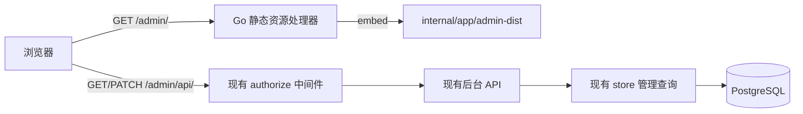

# 后台管理页 React 重构方案

**将 `internal/app` 当前的单文件后台整理为可维护的 React 前端，并继续由 Go 进程提供静态资源和管理 API。**

| 项目 | 内容 |
| --- | --- |
| **状态** | Draft，待开发评审 |
| **负责人** | 项目开发者 |
| **范围** | `/admin/` 管理页的前端实现、静态资源构建和 Go embed 集成 |
| **不包含** | 业务 API 重设计、数据库迁移、QQ 聊天流程调整和生产发布执行 |
| **读者** | 项目开发者、技术评审人、测试人员 |
| **依据** | 当前 `main` 分支源码，基线为 commit `60c042a` |

## 1. 结论

建议采用「React 源码独立维护，Vite 构建，Go embed 提供运行时资源」的方案。前端源码放在 `web/admin/`，构建产物放在 `internal/app/admin-dist/`，Go 仍然在同一个进程中提供 `/admin/` 页面和 `/admin/api/` 接口。

本次重构保留现有 API 路径、请求字段、鉴权规则和数据库修订校验。前端只重构页面状态管理、组件结构、响应式布局、加载反馈和错误处理。这样可以先改善后台的维护成本和使用体验，同时把后端业务风险限制在静态资源路由的调整范围内。

> **Why & What - 采用构建后静态资源**
>
> **What：** React 使用 Vite 构建为带哈希文件名的静态资源，并由 Go `embed` 嵌入二进制。
>
> **Why：** 当前程序以一个 Go 进程提供后台页面，部署和运行时不需要独立的前端服务。静态资源嵌入可以保持这一边界，同时让前端获得 TypeScript、组件化和构建检查能力。这个选择增加了 Node 依赖和构建产物管理成本。
>
> **Alternatives considered：** 继续维护单文件原生脚本的改造成本最低，但页面状态、编辑状态和错误反馈会继续集中在一个文件中。运行独立的前端服务可以简化开发热更新，但会增加部署进程、代理配置和鉴权边界。
>
> **Fallback：** 如果前端构建环境不可用，仓库保留已构建的 `internal/app/admin-dist/`，Go 仍可直接编译和运行。

## 2. 现状依据

以下结论来自当前源码。它们描述的是已存在的行为，不是本方案要新增的能力。

| 现状 | 依据 |
| --- | --- |
| Go 使用 `go:embed` 嵌入单个 `admin.html`，并在 `/admin/` 返回页面 | [`internal/app/admin.go`](../internal/app/admin.go#L20-L21)、[`internal/app/admin.go`](../internal/app/admin.go#L88-L97) |
| 管理 API 位于 `/admin/api/`，包括群列表、对话、笔记、表情包和图片读取 | [`internal/app/admin.go`](../internal/app/admin.go#L99-L188) |
| 配置了 `server.admin_token` 时，API 使用 Bearer 令牌；未配置时只接受回环地址 | [`internal/app/admin.go`](../internal/app/admin.go#L39-L58) |
| 非读请求会校验 `Origin` 是否与当前请求主机一致 | [`internal/app/admin.go`](../internal/app/admin.go#L59-L68) |
| 笔记和表情包修改都携带版本号，存储层用版本号阻止覆盖并发修改 | [`internal/store/admin.go`](../internal/store/admin.go#L56-L106) |
| 页面当前使用原生 DOM 创建节点，连接后读取群、对话和表情包，保存后重新刷新 | [`internal/app/admin.html`](../internal/app/admin.html#L1-L25) |
| HTTP 服务和后台路由由同一个 Go `http.Server` 提供 | [`internal/app/app.go`](../internal/app/app.go#L62-L62) |
| 当前开发文档明确说明后台不需要前端构建 | [`docs/DEVELOPMENT.md`](DEVELOPMENT.md#L3-L3) |

当前工作区在检查时没有 React、Vite、`package.json` 或前端构建目录。上述结论不代表线上页面和本地页面已经完成浏览器联调，浏览器联调需要在实施后补做。

## 3. 目标与非目标

### 3.1 目标

- 将页面拆成可独立理解的 React 组件和 TypeScript 数据类型。
- 将请求、加载、空状态、错误和保存状态作为显式页面状态管理。
- 在桌面和窄屏浏览器上提供可用的导航和编辑布局。
- 保留当前后台 API、鉴权、数据库版本校验和图片路径安全检查。
- 让 Go 直接编译时仍能使用仓库内已生成的前端资源。
- 为前端类型检查、构建检查和 Go 集成测试建立固定命令。

### 3.2 非目标

- 不新增后台业务能力，不增加群操作、主动发言、配置修改或任务执行入口。
- 不修改 `/admin/api/` 的路径、请求字段和响应字段。
- 不修改数据库表、索引、版本号语义和并发冲突处理。
- 不改变令牌传递方式、未配置令牌时的本机访问限制和 `Origin` 校验。
- 不在本次改造中引入 React Router、全局状态库或 UI 组件库。
- 不把后台拆成独立部署的 Node 服务。

## 4. 总体设计

### 4.1 运行时边界

Go 继续负责静态资源、鉴权、API 和数据库访问。浏览器只负责页面状态和交互，数据仍通过现有管理 API 获取。



图中的 `Go 静态资源处理器` 是本方案新增的路由实现，`authorize`、后台 API、存储查询和数据库是现有组件。页面资源请求不经过 API 鉴权，数据请求继续经过现有 API 鉴权；页面本身不携带令牌到 URL。

### 4.2 目录和构建产物

建议新增以下目录和文件：

```text
web/admin/
  package.json
  package-lock.json
  tsconfig.json
  vite.config.ts
  index.html
  src/
    main.tsx
    App.tsx
    api.ts
    types.ts
    styles.css

internal/app/
  admin.go
  admin-dist/
    index.html
    assets/
      index-<hash>.js
      index-<hash>.css
```

`web/admin/` 是人工维护的源码目录。`internal/app/admin-dist/` 是构建输出目录，建议纳入版本控制，以便 `go build ./...` 不依赖本机 Node 环境。持续集成在包含已提交产物的干净检出中执行前端构建，再检查构建目录没有差异，防止源码和 embed 产物不一致。本地实施期间产生的新产物差异属于待提交变更，不能按干净检出的结果判断。

> **Why & What - 保留构建产物**
>
> **What：** 将构建产物提交到 `internal/app/admin-dist/`，并在检查中验证它由当前前端源码生成。
>
> **Why：** 当前 Go 构建链不需要前端工具，保留产物可以继续支持直接编译和部署。代价是每次前端变更都会产生静态文件差异，仓库需要增加产物一致性检查。
>
> **Alternatives considered：** 不提交产物可以减少仓库中的生成文件，但部署或 Go 构建前必须安装 Node 并执行构建，现有部署约束需要重新确认。
>
> **Fallback：** 如果项目后续统一由前端流水线发布资源，可以把 Go embed 改为读取发布包，但这不属于本次改造。

### 4.3 Go 静态资源处理

`internal/app/admin.go` 建议将单文件 embed 改为目录 embed，并把 `/admin/` 下的 `index.html` 和 `assets/` 文件交给 `http.FileServer` 或等价的受限静态文件处理器。

处理器需要满足以下规则：

1. `GET /admin` 继续重定向到 `/admin/`。
2. `GET` 和 `HEAD /admin/` 返回构建后的 `index.html`。
3. 只允许读取 `/admin/assets/` 下的静态文件，其他未知页面路径返回 `404`。
4. 页面资源使用 `Content-Security-Policy` 的 `script-src 'self'` 和 `style-src 'self'`，移除当前内联脚本和内联样式对应的 `unsafe-inline`。
5. `index.html` 使用 `Cache-Control: no-store`，带哈希的静态资源可以使用可缓存响应；如果部署环境无法确认资源更新策略，先统一使用 `no-store`。
6. 静态资源处理器不绕过 `/admin/api/` 的现有路由和 `authorize` 中间件。

构建配置的 `base` 需要设置为 `/admin/`，否则 Vite 生成的资源路径会从站点根路径加载，访问 `/admin/` 时会得到 `404`。

### 4.4 前端页面结构

页面采用一个 React 根组件和按功能拆分的展示组件。首版不增加客户端路由，导航只切换当前视图，浏览器入口仍然只有 `/admin/`。

```text
AdminApp
├── Sidebar
├── TopBar
├── ConnectionBar
├── StatusBanner
├── OverviewStats
├── ConversationPanel
├── NotesPanel
│   └── NoteEditor
├── AttemptsPanel
│   └── AttemptDetails
└── StickersPanel
    └── StickerCard
```

页面导航包含四个视图：最近对话、相处笔记、回应记录和全局表情包。视图标题旁展示当前数据量，空状态明确区分「尚未连接」「没有数据」和「读取失败」。

桌面布局使用侧边导航和主内容区。窄屏布局将侧边导航收起为可展开菜单，编辑器和表情包卡片改为单列。颜色只用于辅助表达状态，状态标签同时提供文字，按钮和表单控件保持键盘可操作。

> **Why & What - 保持单页客户端结构**
>
> **What：** 首版只使用 React 组件和页面内状态，不引入 React Router、全局状态库或 UI 组件库。
>
> **Why：** 当前后台只有一个页面入口和四个功能视图，页面状态可以由根组件和局部编辑器管理。减少依赖可以把重构重点放在 API 状态、鉴权反馈和响应式布局上。代价是表格、状态标签和通用样式需要由项目维护。
>
> **Alternatives considered：** React Router 可以提供可分享的视图 URL，组件库可以减少表单和卡片样式工作，但当前 API 没有视图路由需求，新增依赖会扩大首版改动范围。
>
> **Fallback：** 如果后续需要深链接或复杂表单，再按实际页面数量单独引入路由或组件库。

## 5. API 和状态设计

### 5.1 保留的 API 合同

React 客户端只封装现有管理 API，不在浏览器中直接访问数据库。

| 方法 | 路径 | 用途 | 前端处理 |
| --- | --- | --- | --- |
| `GET` | `/admin/api/groups` | 读取群 ID 列表 | 连接后台时读取，保留当前选中群 |
| `GET` | `/admin/api/conversation?group=<id>` | 读取消息、笔记和回应记录 | 切换群或刷新时读取 |
| `PATCH` | `/admin/api/notes/{id}` | 保存或遗忘笔记 | 携带 `group`、`version`、`text`、`forget` |
| `GET` | `/admin/api/stickers` | 读取全局表情包列表 | 连接后台和刷新时读取 |
| `PATCH` | `/admin/api/stickers/{id}` | 保存描述或禁用表情包 | 携带 `version`、`description`、`blocked` |
| `GET` | `/admin/api/stickers/{id}/image` | 读取表情包图片 | 以 `Blob` 创建预览 URL，组件卸载时释放 |

页面请求通过统一的 `api.ts` 发起。`types.ts` 手工映射现有响应中的 `qq.Event`、`memory.Note`、`chat.Attempt` 和 `meme.Asset` 可见字段，不生成新的后端 DTO。令牌放在内存状态中，存在时使用 `Authorization: Bearer <token>`。前端不把令牌写入 `localStorage`、查询参数或错误日志。`401` 和 `403` 统一提示鉴权失败，`409` 提示数据已被其他操作修改并重新读取对应数据。

### 5.2 页面状态

`AdminApp` 管理连接和页面级状态，编辑器只管理本地草稿。建议使用以下状态：

| 状态 | 作用 | 生命周期 |
| --- | --- | --- |
| `token` | 当前会话的访问令牌 | 页面内存，刷新页面后清空 |
| `groups` | 可访问群 ID | 连接或刷新时替换 |
| `selectedGroup` | 当前群 | 用户切换群时更新 |
| `conversation` | 当前群的消息、笔记和回应记录 | 切换群、刷新或保存后更新 |
| `stickers` | 全局表情包列表 | 连接、刷新或表情包保存后更新 |
| `activeView` | 当前导航视图 | 页面内存 |
| `requestState` | 连接、读取、保存和预览状态 | 按请求粒度更新 |
| `notice` | 成功、错误或提示信息 | 下一次操作或定时清除 |

请求状态需要按对象区分。例如保存一条笔记时，只禁用该笔记的保存按钮，其他笔记仍可编辑。组件提交时使用 API 返回前已经读取的 `version`，不要在前端自行递增版本号。

### 5.3 交互流程

连接后台：

1. 用户输入令牌并点击「连接后台」。
2. 页面请求群列表。
3. 页面选择当前仍存在的群，若没有当前选择则选择列表中的第一个群。
4. 页面并行读取该群的对话数据和全局表情包。
5. 页面显示可用的视图和数据统计。

切换群：

1. 页面立即更新选中群，并显示对话区域的加载状态。
2. 页面只请求新群的 `/admin/api/conversation?group=<id>` 数据。
3. 页面保留表情包列表，避免全局数据随群切换重复读取。

保存笔记或表情包：

1. 页面锁定当前对象的操作按钮。
2. 页面发送原始版本号和编辑内容。
3. `200` 时重新读取受影响的数据并显示成功状态。
4. `409` 时提示版本冲突并重新读取受影响的数据，保留服务端结果。
5. 其他错误时恢复按钮，保留未提交的本地草稿，并显示错误原因。

预览表情包：

1. 页面请求图片接口并读取 `Blob`。
2. 页面通过 `URL.createObjectURL` 显示图片。
3. 卡片卸载、切换图片或刷新列表时调用 `URL.revokeObjectURL`。
4. `404` 时显示「文件不可用」，不把预览失败当成保存失败。

## 6. 安全和兼容性

### 6.1 保持的安全边界

- API 继续使用 `authorize` 中间件，前端不复制鉴权逻辑来替代服务端检查。
- 未配置令牌时继续依赖服务端的回环地址判断，前端不根据浏览器地址自行放宽访问范围。
- 非读请求继续由服务端检查 `Origin`。
- 图片预览继续使用服务端校验后的图片接口，前端不接收或拼接本地文件路径。
- 用户内容继续通过 React 文本节点或受控表单渲染，不使用 `dangerouslySetInnerHTML`。
- `index.html` 和静态脚本不使用内联脚本，CSP 可以移除 `script-src 'unsafe-inline'`。

### 6.2 兼容性边界

页面入口、API 路径和后端响应保持不变，现有书签和后台配置不需要调整。构建产物路径改为 `/admin/assets/`，Go 路由需要覆盖该路径。若部署在反向代理的子路径下，代理必须继续转发 `/admin/` 和 `/admin/api/`，具体代理配置不在仓库当前文档中，属于部署侧待确认事项。

## 7. 实施顺序

每项工作都应留下可独立检查的结果。前端源码和 Go 路由可以分开开发，但在浏览器联调前必须完成一次完整构建。

| 顺序 | 目标 | 主要文件 | 检查方式 |
| --- | --- | --- | --- |
| 1 | 建立前端工程和类型边界 | `web/admin/package.json`、`web/admin/tsconfig.json`、`web/admin/vite.config.ts`、`web/admin/src/types.ts`、`web/admin/src/api.ts` | `rtk npm ci`、`rtk npm run typecheck` |
| 2 | 完成页面骨架和只读视图 | `web/admin/src/App.tsx`、`web/admin/src/styles.css` | 类型检查，浏览器检查连接、群切换、四个空状态和窄屏布局 |
| 3 | 接入笔记和表情包编辑 | `web/admin/src/App.tsx` 或拆分后的组件文件 | 检查成功保存、遗忘、禁用、恢复、`401`、`403` 和 `409` |
| 4 | 接入静态资源 embed | `internal/app/admin.go`、`internal/app/admin-dist/`、`internal/app/admin_test.go` | 检查 `/admin/`、`/admin/assets/*`、CSP、错误路径和 API 鉴权 |
| 5 | 更新构建说明和开发入口 | `Makefile`、`README.md`、`CLAUDE.md`、`docs/DEVELOPMENT.md`、`docs/README.md` | 前端构建、Go 测试、Go 构建和文档链接检查 |
| 6 | 删除旧页面实现 | `internal/app/admin.html` | 确认没有源码或文档继续引用旧单文件入口 |

建议的前端脚本如下：

```json
{
  "scripts": {
    "dev": "vite",
    "typecheck": "tsc --noEmit",
    "build": "vite build",
    "check": "npm run typecheck && npm run build"
  }
}
```

`vite.config.ts` 需要固定 `base: "/admin/"`，将 `outDir` 指向 `../../internal/app/admin-dist`，并在开发服务器中把 `/admin/api` 代理到本地 Go 服务。开发代理只用于本地开发，不改变生产运行时拓扑。

## 8. 测试和验收标准

### 8.1 自动检查

实施完成后，以下命令需要通过：

```bash
cd web/admin
rtk npm ci
rtk npm run typecheck
rtk npm run build
cd ../..
rtk go test -race ./...
rtk proxy go vet ./...
rtk go build ./...
rtk git diff --check
```

在包含已提交源码和 embed 产物的干净 CI 检出中，执行构建后再运行 `rtk git diff --exit-code -- internal/app/admin-dist`。该检查确认构建输出与源码一致；本地实施期间不使用这个命令判断工作区是否应该有差异。

### 8.2 Go 集成检查

`internal/app/admin_test.go` 建议增加以下测试：

- `GET /admin/` 返回 `200`、HTML 内容和 React 根节点。
- 从入口 HTML 提取的 JavaScript 资源路径可以通过 `/admin/assets/` 返回。
- `/admin/unknown` 不返回目录列表。
- 页面响应包含静态脚本对应的 CSP，不包含 `script-src 'unsafe-inline'`。
- `/admin/api/` 仍然经过原有令牌、本机地址和 `Origin` 校验。
- `/admin` 仍然重定向到 `/admin/`。

这些测试只验证资源路由和安全边界，不替代真实浏览器联调，也不需要数据库连接。

### 8.3 浏览器验收

测试人员使用已配置和未配置 `server.admin_token` 的环境分别验证：

1. 未配置令牌且从本机访问时可以连接后台，远程来源收到 `403`。
2. 配置令牌后，空令牌收到 `401`，正确 Bearer 令牌可以读取数据。
3. 连接后台后可以读取群列表，切换群只更新当前群数据。
4. 消息、撤回标记、笔记状态、回应状态和检索详情与 API 返回一致。
5. 保存笔记、遗忘笔记、保存表情描述和禁用表情包后，刷新页面仍显示服务端结果。
6. 模拟版本冲突时，页面提示冲突，不覆盖服务端的新版本。
7. 可用表情包可以预览，文件不存在时页面只提示预览不可用。
8. 桌面和窄屏宽度下，导航、表单、文本和按钮都可操作，长文本不会撑破布局。
9. 浏览器控制台没有资源路径、CSP、未处理 Promise 或 React 渲染错误。

## 9. 回滚和发布边界

本方案不需要数据库迁移，也不改变后台 API。回滚只需要恢复上一版 Go 静态资源处理逻辑和 `admin.html` embed 文件，再重新构建 Go 二进制。API 和数据库数据可以继续由旧版后台读取。

首次上线前需要完成一次包含真实 API 的浏览器联调。没有完成这项联调时，只能确认源码、构建结果和 Go 路由测试通过，不能宣称后台页面已在目标部署环境可用。

生产发布仍由现有 Go 二进制发布流程负责。Node 只参与构建和产物一致性检查，不进入运行时依赖清单。

## 10. 收益、成本和风险

| 项目 | 内容 |
| --- | --- |
| 收益 | 页面状态、编辑器和请求逻辑可以按组件维护；TypeScript 和 Vite 提供构建期检查；响应式布局和错误反馈可以集中实现 |
| 成本 | 增加 Node、npm lockfile 和前端产物；前端开发者需要同时理解 Go embed 路由和 Vite 资源前缀 |
| 风险 | 构建产物未更新会导致源码和运行页面不一致；`base` 配置错误会导致资源 `404`；版本冲突处理不完整会覆盖本地草稿或服务端数据 |
| 控制措施 | 构建产物一致性检查、Go 静态资源测试、`409` 专门测试、真实 API 浏览器验收和回滚路径检查 |

本次方案不引入 UI 组件库可以减少依赖和样式迁移工作，但页面需要自行维护表格、状态标签和响应式样式。若后续后台出现复杂表单、分页表格或权限矩阵，再单独评估组件库的引入范围。

## 11. 待确认事项

| 问题 | 影响 | 负责人 |
| --- | --- | --- |
| 部署流水线是否允许在构建阶段安装 Node 依赖 | 决定是否能在流水线重新生成 `admin-dist` | 项目维护者 |
| `internal/app/admin-dist/` 是否接受作为版本控制中的生成目录 | 决定 Go 直接构建是否继续不依赖 Node | 项目维护者 |
| 是否需要通过 URL 直接打开某个后台视图 | 若需要，需增加路由或查询参数设计 | 使用方代表 |
| 是否有统一的前端视觉规范或组件库 | 决定是否调整首版 CSS 和依赖范围 | 使用方代表 |
| 访问令牌是否允许在浏览器会话内持久化 | 影响安全边界和登录体验 | 安全负责人 |

在这些问题确认前，可以按本文推荐方案实施。除「是否持久化令牌」外，其他问题不会改变现有 API 合同；令牌持久化若要采用，需要单独评估浏览器存储风险。

> 本文的现状结论均来自源码依据表，React 工程、资源路由、组件结构和验收项属于待评审的设计提案。评审重点是构建产物管理、部署流水线和令牌会话策略。
