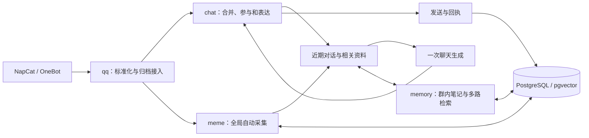

# 项目架构

当前实现是模块化单体。`internal/app` 组装 QQ、模型、记忆、表情包与 PostgreSQL；`internal/chat` 维护按群独立的聊天流程。QQ 接入、聊天与后台能力在同一个 Go 进程内，NapCat、数据库和模型服务是外部依赖。

## 目录布局

源码按职责在 `internal` 下平铺，模块内部先按文件组织，不额外增加应用层、领域层或适配器层。

```text
cmd/
  qqbotd/         # 在线进程
  replay/         # 离线回放命令
internal/
  app/            # 依赖组装、HTTP 与嵌入页面
  chat/           # 群聊协调与表达
  config/         # 配置加载与校验
  memory/         # 笔记、学习与记忆检索
  meme/           # 全局表情包采集与复用
  model/          # 聊天、视觉与 Embedding 客户端
  qq/             # OneBot 协议与媒体获取
  store/          # PostgreSQL 查询与事务
  search/         # 融合算法与 bm25 子包
  replay/         # 回放使用的内存存储和模拟发送
  architecture/   # 模块边界检查
configs/          # 配置示例与忽略入库的本地配置
schema/           # 嵌入的数据库基线
tests/replay/     # 对话回放样例
docs/             # 当前架构和开发说明
```

`cmd/replay` 是命令入口，`internal/replay` 提供回放运行依赖。`data/`、`memes/` 和 `bin/` 属于本地运行数据或构建产物，按需生成，不提交到 Git。



## 模块职责

| 模块 | 职责与源码 |
| --- | --- |
| 进程与运维 | [app](../internal/app/app.go)、[admin](../internal/app/admin.go)：配置组装、后台、接入、关闭 |
| QQ 协议 | [qq](../internal/qq/qq.go)：事件身份、说话人与引用、WebSocket 重连、字面消息段和回执；[media](../internal/qq/media.go)：有界图片获取 |
| 聊天 | [chat](../internal/chat/chat.go)：按群合并、参与判断、模型输出校验、发送预算与结果 |
| 记忆 | [memory](../internal/memory/memory.go)：有证据的笔记、纠正与遗忘、多路召回、后台整理和索引修复 |
| 表情包 | [meme](../internal/meme/meme.go)：自动采集、全局内容去重、描述、召回、冷却与容量回收 |
| 模型 | [model](../internal/model/client.go)：聊天、图片、Embedding 客户端与请求并发，不执行工具 |
| 存储 | [store](../internal/store/store.go)、[stickers](../internal/store/stickers.go)：数据库查询、事务、源版本和发送记录 |
| 检索算法 | [BM25](../internal/search/bm25/bm25.go)、[RRF](../internal/search/fusion.go)：无 I/O 的排序与融合 |
| 回放 | [replay](../cmd/replay/main.go)、[内存存储](../internal/replay/store.go)：复用聊天流程，隔离存储并模拟发送 |

## 聊天与参与

每条获准处理的入站事件先以平台事件身份去重并归档，再进入所属群的有界缓冲。不同成员复读同一句话仍是不同事件，不按文字内容去重。作者、时间、消息标识和引用关系保持独立。

每群的协调器合并短时间内的分条消息，同时设置最长等待。明确 @、点名和引用机器人时优先处理；机器人刚参与过的对话保留内存中的活跃窗口，让相关参与者的无 @ 追问也能继续。优先处理只影响调度，是否回应由模型结合完整语境判断。

普通新消息进入后续缓冲，不取消正在生成的回答。新的明确互动会使旧草稿失效；撤回会使相关在途判断过期。模型请求不持有群状态锁，各群可以并行。空闲群的协调器会回收，重启不恢复尚未完成的聊天回合。

上下文包含近期真实对话、当前批次、稳定人物配置、有效笔记、已加载图片与少量表情包候选。近期对话按字符预算裁剪；其他输入分别受事件缓冲、笔记长度、召回数与媒体数量限制。当前模型输出只有沉默、文字或表情包这一份表达结果，引用对象和素材必须来自可见资料。

普通插话受间隔限制，直接互动和活跃对话可以绕过插话间隔；每群发言总额仍然生效。模型不可用、结构错误或没有实际内容时，不发送模板话术。稳定口吻、偏好和相处证据提供人物连续性，没有情绪、精力、好感或信任加分系统，也不自动扩写人物履历。

## 记忆与检索

长期笔记分为群信息、成员近况、经历与明确偏好，共用一套来源、修订和失效规则。成员信息只能由本人消息提供证据；群、作者和逐字引用由程序检查。明确的记住、纠正和遗忘请求可随本轮表达附带修改，写入成功后才发送确认。

后台从持久化消息游标增量整理笔记，旁听期间也可学习。笔记修改与游标推进在同一事务提交；失败延后该群的整理。普通生成文本和未送达草稿不能作为学习证据。

称呼、明确偏好和相处约定按群与参与者直接读取，不占经历检索的名额。其他资料使用以下轨道：

| 轨道 | 作用 |
| --- | --- |
| 语义向量 | 使用 Embedding 与 pgvector 找回换一种说法的旧话题 |
| BM25 词法 | 找回原话、人名、游戏名和群内词，中文使用单字与相邻双字片段 |
| 人物和时间 | 补充相关成员与明确时间线索下的经历；当前识别今天、昨天、前天和 ISO 日期 |

各路先限制群、有效状态和有效期，再使用 RRF 融合并去重。未核实的转述保留来源，检索排名不能把它升级为事实。当前词法轨道最多扫描本群的 5,000 条笔记，没有持久化倒排索引；语义召回直接查询数据库向量索引。召回范围、排序和降级由 [memory.Recall](../internal/memory/memory.go) 实现。

笔记修订时使旧向量失效，后台仅为同一内容版本提交新索引。遗忘保留必要的失效证据，阻止旧消息被换一个属性名重新抽取。查询和索引写入都检查源状态与版本。Embedding 模型标识变化后，旧投影不参与当前召回，并由后台重新生成。

向量故障时保留词法与人物、时间轨道。普通记忆读取故障可退回近期对话；明确的保存或遗忘失败不能返回成功文案。各路命中、最终笔记标识和降级状态保存在回应尝试中。

## 全局表情包

自动采集只消费获准群中的入站图片与贴纸，不要求主动收藏或逐张人工确认。候选先保存处理状态并有界下载，按内容哈希全局合并；同一份已理解内容不重复调用素材分类模型。GIF 原文件保留用于发送，理解时使用首帧。

模型判断素材是否适合重复表达，生成简短含义和适用标签。普通照片、私人截图和看不懂的内容不应成为可发送素材。源事件和源群只用于内部追溯，不进入提供给聊天模型的全局素材信息；群内特定梗的背景仍属于群内记忆。

文字描述参与词法与向量召回，融合后提供少量全局候选。发送前重新检查素材可用性。重复发送冷却根据该群确认送达的记录计算，在 A 群使用不会阻止 B 群使用同一张图。

后台控制全局素材数量与磁盘用量，优先保留近期出现、可用的素材。禁用状态随内容身份保留，避免同图再次出现时重新收入。处理进度持久化；未配置模型不消耗失败次数，其他采集失败最多尝试五次，运维可查看状态并纠错。当前自动采集质量取决于图片模型，不保证所有普通图片都能正确分类。

## 发送与关闭

模型结果经校验与发送前检查后，先记录发送中状态，再调用 OneBot。成功回执与真实出站归档同事务提交；冷却从确认送达记录计算。模型文字以字面消息段发送，正文中的 CQ 字符串不会成为额外动作。

平台调用与 PostgreSQL 事务不能原子提交。网络超时、发送期间退出或回执成功后归档失败，都保留不确定状态并停止自动补发。只有确认送达的内容才进入真实聊天历史，不承诺跨系统恰好一次。

启用 QQ 时，数据库会话锁限制同一数据库只有一个新运行时拥有发送权，发送前检查锁连接仍可用。它不管理旧版本进程，切换时必须先停止旧实例。健康检查同时检查数据库、发送锁和 QQ 连接。

退出时先取消接入和后台生产，关闭 HTTP，等待群协调器、在途模型调用与发送收尾，再等待后台工作并关闭数据库。已发送后的记录收尾使用独立、有界的上下文。模型、Embedding 和素材理解共享并发上限，后台同时最多占用一个请求名额；已开始的后台调用不会被抢占。

## 数据与验证

当前表、向量版本和命名空间见 [数据库说明](../schema/README.md)。运行配置只包含群友方向所需能力，不接受旧工具配置，也没有通用工具循环或持久化聊天任务队列。

程序测试与回放说明见 [开发说明](DEVELOPMENT.md)。本地测试覆盖事件顺序、范围、版本、发送、关闭和自动采集；自然表达质量与真实 QQ 行为需要额外使用目标模型和群聊验证。
