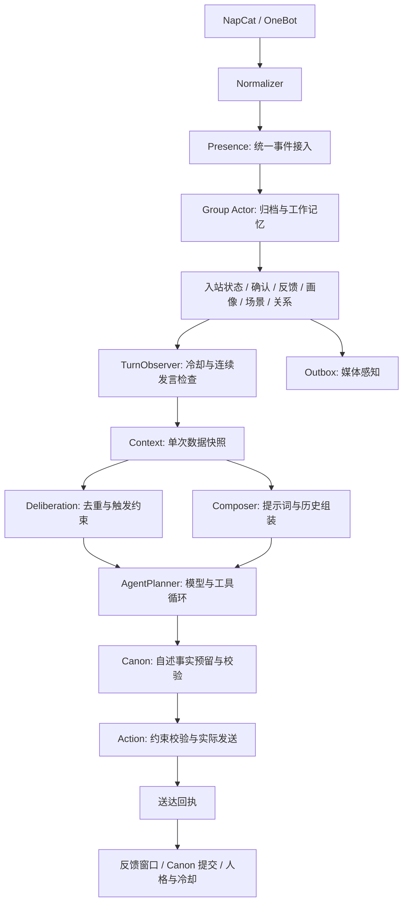

# 项目架构

本文是当前架构的唯一入口。项目定位和功能地图见 [PROJECT.md](./PROJECT.md)。实现采用模块化单体与 Ports and Adapters：一个进程内组织群友能力，外部协议和存储通过接口接入。

## 运行主链路



`SubmitRaw` 与 CLI 的 `ProcessRawEvent` 共用事件接入和回合逻辑。两者只在等待方式上不同：在线入口完成事件接入后启动模型回合，CLI 等待回合结果。限流不会跳过事件归档、成员投影和感知任务。

同群新回合取消旧回合；跨群可以并发。群状态由 Actor 锁保护，模型请求不持有群锁。Actor 只保留有界历史与去重集合，完整事件存放在 PostgreSQL。回合使用 45 秒截止时间，发送前检查取消状态。运行时关闭停止接收新操作，取消并等待已经接入的事件、模型回合及发送后收尾。

## 职责与依赖

| 边界 | 唯一职责 | 代码入口 |
| --- | --- | --- |
| 进程入口 | 配置、信号、运行模式和退出码；返回错误后再退出，保证清理执行 | `cmd/qqbotd/main.go` |
| 依赖组装 | 存储、模型、工具、业务能力、HTTP 和资源所有权 | `internal/app/app.go`、`runtime_builder.go` |
| 事件接入 | 忽略规则、归档、入站观察及在线/同步入口 | `application/presence/ingestion.go` |
| 回合执行 | 规划、临时工作区、Canon、发送与送达后的状态收尾 | `application/presence/turn.go` |
| 回合生命周期 | 取消、同群替换、超时、Actor 回收及关闭等待 | `application/presence/lifecycle.go` |
| 上下文 | 读取历史、记忆、画像、关系、场景、人格、策略和相处约束，产出 `ContextSnapshot` | `application/context/service.go` |
| 参与与计划 | 低成本去重，触发类型允许动作，调用 Planner 并解析最终动作 | `presence/deliberation/deliberator.go` |
| 提示词 | 只消费快照；组装稳定指令、动态数据、对话历史和预算 | `application/prompting/composer.go` |
| 模型与工具 | Eino Agent 循环、工具能力与调用预算、用量记录、失败回退 | `application/prompting/agent_planner.go`、`application/tools` |
| 表达执行 | 按解析后的决定校验和执行动作，返回真实回执 | `application/action/executor.go` |

`presence.Dependencies` 在启动前一次组装完成。`TurnObserver` 包含入站、规划许可和回合完成三个生命周期方法。Deliberator 接收事件，由 Context 读取并组装快照。

分层方向：

```text
cmd -> app -> application -> domain
           -> adapters -> application/ports + domain
           -> search（无 I/O 算法）
```

`domain` 不依赖应用、数据库或网络；`application` 不依赖 adapter 或 app；adapter 不依赖 app。依赖方向由 [layers_test.go](../internal/architecture/layers_test.go) 检查。

## 人格与模型自主性

稳定配置编译为 `PersonaDefinition`，有效人物事实生成 `PersonaView`。全局 `PersonaState` 描述情绪、精力和说话倾向；群场景和关系描述当前相处语境。它们影响模型选择，不扩展为固定角色切换状态机。

Canon 区分锁定、管理员管理、允许一次补全、可修改及禁止补全的槽位。公开自述先准备提案，只有实际送达文本中的事实才提交；静默和失败发送不写成已经发生的经历。未核实转述不升级为虚拟人物亲历，更不能包装成现实可验证事实。

## 数据与记忆

| 权威数据 | 表 | 派生数据或使用方 |
| --- | --- | --- |
| 真实收发事件 | `messages` | 工作记忆、场景、画像、关系、模型历史 |
| 长期记忆与偏好 | `memories` | BM25、`memory_vectors`、相处约束快照 |
| 素材与描述 | `meme_assets`、`meme_descriptors` | `meme_vectors`、表情包检索 |
| 人物事实 | `persona_fact_events`、`persona_fact_reservations` | `PersonaView` |
| 运行状态 | `runtime_states`、`group_working_memory` | 冷却、全局人格状态与群上下文 |
| 关系与群场景 | `relationships`、`relationship_events`、`relationship_history`、`member_profiles`、`group_scenes` | 相处语境 |
| 观测与任务 | `thought_records`、`retrieval_traces`、`model_usage_records`、`learning_event_progress`、`async_outbox` | 管理后台与后台执行 |

显式记忆与后台学习共用 `memory.Service` 写入路径。学习保留证据和结构化偏好，偏好通过 `postgres.Store.GetConstraints` 从同一张表读取。结构化字段使用 `predicate`、`normalized_value`、`qualifier`，有效期使用 `expires_at`。Schema 的加载和变更边界见 [数据库说明](../schema/README.md)。

Context 加载当前说话人的相处偏好。Composer 消费快照中的约束来生成称呼和互动提醒；Action 使用同一份约束校验实际戳和 @ 动作。普通检索、画像、关系与场景读取失败可以降级；人物事实、运行状态和相处约束读取失败会阻止本轮规划。

模型历史由真实收发事件重建；工具草稿、静默计划和未送达文字不持久化为对话。可变上下文按字节裁剪，预算集中在 [prompting/budget.go](../internal/application/prompting/budget.go)。工具 schema 按群白名单和触发场景选择；模型循环和工具次数限制集中在 [agent_runtime_guard.go](../internal/application/prompting/agent_runtime_guard.go)，使用与配置见 [工具说明](./TOOLS.md)。

## 送达与关闭

送达回执是事实边界。即使多气泡回复只送达一部分，反馈、Canon 和冷却也必须基于实际送达内容收尾。已送达后的 hook 使用脱离原回合取消状态、上限 5 秒的 context；单个 hook 失败不跳过后续 hook。

资源按生产者先停、依赖后停的顺序关闭：

```text
Run 停止 WebSocket 接入与 HTTP
  -> Scheduler 停止定时生产
  -> Presence 停止接入、取消并等待回合与 hook
  -> Outbox 停止 worker 并提交任务终态
  -> Group Actor / MCP
  -> PostgreSQL
```

依赖组装失败与正常关闭共用同一清理函数。HTTP 或接入失败也会取消其余 Run 工作，CLI 错误通过返回值上报，避免 `os.Exit` 跳过资源清理。

## 检索与 Outbox

检索统一经过 scope/expiry/type 硬过滤、BM25 与向量候选、RRF 去重、领域排序。检索索引是可重建投影，不是事实来源。详情见 [混合检索](./RETRIEVAL.md)。

可重放副作用使用 Outbox，包含感知、记忆与素材索引、学习、发送计数和 Canon 抽取/完成任务。支持事务原子写入的事实与索引任务同事务提交；其余入队与回退行为按各用例执行，不能宣称所有副作用都已原子化。详情见 [ADR-0001](./adr/0001-runtime-lifecycle-and-outbox.md)。

## 可靠性边界

当前实现仍是单进程、合作式取消：外部模型或工具必须响应 context。没有全局模型并发限额，也没有可跨重启恢复的聊天回合。QQ 发送幂等只在进程内，不保证平台侧恰好一次；发送与出站归档也尚未具备事务闭环。视觉理解和学习异步完成，不保证第一轮就看到增强结果。

项目能力边界见 [项目定位与功能](./PROJECT.md)，构建和验证方式见 [开发说明](./DEVELOPMENT.md)。
