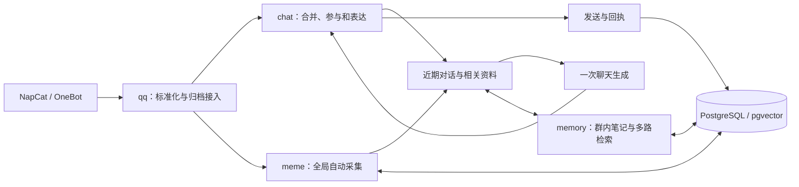

# 项目架构

当前实现是模块化单体。`internal/app` 组装 QQ、模型、记忆、表情包与 PostgreSQL；`internal/chat` 维护按群独立的聊天流程。QQ 接入、聊天与后台能力在同一个 Go 进程内，NapCat、数据库和模型服务是外部依赖。

## 目录布局

源码按职责在 `internal` 下平铺，模块内部先按文件组织，不额外增加应用层、领域层或适配器层。

```text
cmd/
  qqbotd/         # 在线进程
  replay/         # 离线回放命令
internal/
  app/            # 依赖组装、HTTP 与嵌入页面
  cache/          # 有界 TTL-LRU、版本化缓存键与请求合并
  chat/           # 群聊协调、准入、回合快照与表达
  config/         # 配置加载与校验
  context/        # 准入快照与完整上下文快照契约
  conversation/   # 群会话关系、话题数据、持久化结构与摘要任务
  delivery/       # 发送状态机
  memory/         # 笔记、学习与记忆检索
  meme/           # 全局表情包采集与复用
  model/          # 聊天、视觉与 Embedding 客户端
  policy/         # 回复预算与互动判定
  qq/             # OneBot 协议与媒体获取
  store/          # PostgreSQL 查询与事务
  search/         # 融合算法与 bm25 子包
  replay/         # 回放使用的内存存储和模拟发送
  architecture/   # 模块边界检查
configs/          # 配置示例与忽略入库的本地配置
schema/           # 嵌入的数据库基线
tests/replay/     # 对话回放样例
docs/             # 当前架构和开发说明
```

`cmd/replay` 是命令入口，`internal/replay` 提供回放运行依赖。`data/`、`memes/` 和 `bin/` 属于本地运行数据或构建产物，按需生成，不提交到 Git。



## 模块职责

| 模块 | 职责与源码 |
| --- | --- |
| 进程与运维 | [app](../internal/app/app.go)、[后台循环](../internal/app/background.go)：配置组装、后台调度、接入与关闭 |
| 后台管理 | [admin](../internal/app/admin.go)、[API](../internal/app/admin_api.go)、[静态资源](../internal/app/admin_assets.go)、[鉴权](../internal/app/admin_auth.go)：路由、管理接口、嵌入页面和安全边界 |
| QQ 协议 | [qq](../internal/qq/qq.go)：基于 onebot-sdk 的事件身份、说话人与引用、WebSocket 重连、字面消息段和回执；[media](../internal/qq/media.go)：有界图片获取 |
| 会话数据 | [conversation](../internal/conversation/actor.go)：群 Actor 契约、话题与关系数据类型；[摘要任务](../internal/conversation/summarizer.go)：独立游标的后台话题摘要 |
| 聊天 | [chat](../internal/chat/chat.go)、[准入与快照](../internal/chat/boundaries.go)、[回合](../internal/chat/turn.go)：按群合并、预算准入、快照组装、模型输出校验、发送预算与结果 |
| 上下文契约 | [context](../internal/context/builder.go)：准入快照、完整上下文快照、固定预算与深拷贝 |
| 参与策略 | [policy](../internal/policy/policy.go)：直接互动、话题延续、自发间隔和每分钟总额 |
| 记忆 | [memory](../internal/memory/memory.go)：有证据的笔记、话题经历、纠正与遗忘、多路召回、有效期、索引缓存、后台整理任务 |
| 表情包 | [meme](../internal/meme/meme.go)：自动采集、全局内容去重、描述、召回、冷却与容量回收 |
| 模型 | [model](../internal/model/client.go)：聊天、图片、Embedding 客户端与分池并发；[gateway](../internal/model/gateway.go)：请求边界、Embedding 缓存与观测 |
| 缓存 | [cache](../internal/cache/cache.go)、[键](../internal/cache/keys.go)：有界 TTL-LRU、请求合并与版本化键 |
| 存储 | [store](../internal/store/store.go)、[stickers](../internal/store/stickers.go)：数据库查询、事务、话题持久化、源版本和发送记录 |
| 检索算法 | [BM25](../internal/search/bm25/bm25.go)、[RRF](../internal/search/fusion.go)：无 I/O 的排序与融合 |
| 回放 | [replay](../cmd/replay/main.go)、[内存存储](../internal/replay/store.go)：复用聊天流程，隔离存储并模拟发送 |

## 聊天与参与

每条获准处理的入站事件先以平台事件身份去重并归档，再进入所属群的有界缓冲。不同成员复读同一句话仍是不同事件，不按文字内容去重。作者、时间、消息标识和引用关系保持独立。

每群的协调器合并短时间内的分条消息，同时设置最长等待。明确 @、点名和引用机器人时优先处理。程序还为每个群维护一张进程内、按群隔离的动态话题图；最多保留 256 个活跃群，每群最多 64 个话题、512 个事件归属，每个话题保留最近 12 条事件，超出时淘汰最久未活跃的数据。话题图优先沿用既有归属和引用链，其次用 BM25 词面相似度软聚类，同一作者在九十秒内连续分条时可跟随上一事件；参与者和近邻时间只用于候选重排，不能单独决定归属。一条消息最多关联两个候选，因此“爬山还是火锅”既可以保留歧义，也不会因作者相同而强行并入另一话题。话题状态分为 `active`、`warm`、`dormant`，并记录机器人是否参与及最近参与时间。群协调器空闲后回收，话题图、事件归属和话题 ID 继续持久化到 `conversation_topics` 与 `conversation_topic_events`；重启后恢复事件归属、词面窗口和 ID 续号，引用消息仍命中原话题。

普通新消息进入后续缓冲，不取消正在生成的回答。新的明确互动会使旧草稿失效；撤回会使相关在途判断过期。模型请求不持有群状态锁，各群可以并行。空闲群的协调器会回收，重启不恢复尚未完成的聊天回合。

每个回合先执行一次轻量准入：读取历史尾部、话题关系和发送预算，不调用模型、Embedding 或媒体。预算不足或处于自发间隔时只记录一个被限流的回合，不占检索与生成容量。准入通过后，`ContextBuilder` 冻结一份不可变快照，历史、批次、话题、笔记、表情包、图片和查询向量由记忆、表情包、图片与聊天模型共享。当前批次最多 8 条、历史 24 条、话题摘要 4 条、表情包 5 个、图片 2 张；快照返回前复制所有可变成员。

上下文包含裁剪后的既往对话、当前批次、对话关系、稳定人物配置、有效笔记、已加载图片与少量表情包候选。`conversation_context` 为可见事件标出直接互动、回复机器人、活跃对话、普通群聊、机器人发言和撤回关系，并给出每条事件的一个或两个 `topic_ids`。话题侧只暴露状态、参与者、近期事件、机器人是否参与和已提交摘要；事件原文仍在历史与批次中。撤回消息保留原话题归属，不会另建话题。其他输入分别受事件缓冲、笔记长度、召回数与媒体数量限制。

模型先给出本轮回复计划，明确目标事件、`topic_id` 和 `silent`、`ack`、`short`、`answer`、`sticker` 中的表达节奏，再产生沉默、文字或表情包这一份实际结果。目标事件以及发送引用都必须来自本轮可见对话；话题必须可见，且目标事件必须属于所选话题。若只给出目标事件，程序从该事件的候选归属中补出首选话题。发送并成功归档后，程序才把机器人记为该话题的参与者。表达计划只约束现有的一次生成，不增加额外模型调用。后台摘要任务按独立游标读取已持久化的话题事件，提交结构化摘要、证据事件 ID、话题版本和覆盖序号；模型或写库失败只延后重试，不推进游标，也不阻塞聊天。

普通插话受间隔限制，直接互动和活跃对话可以绕过插话间隔；每群发言总额仍然生效，并在发送前再复核一次，但不会重新调用模型。模型不可用、结构错误或没有实际内容时，不发送模板话术。稳定口吻、偏好和相处证据提供人物连续性，没有情绪、精力、好感或信任加分系统，也不自动扩写人物履历。

## 记忆与检索

长期笔记分为群信息、成员近况、经历与明确偏好，共用一套来源、修订和失效规则。成员信息只能由本人消息提供证据；群、作者和逐字引用由程序检查。明确的记住、纠正和遗忘请求可随本轮表达附带修改，写入成功后才发送确认。笔记身份在写入时统一规范：`key` 去除首尾空白并转小写，`topic_id` 去除首尾空白；episode 的身份包含 `topic_id`，其他类型不包含。历史重复清理后创建只约束 `active` 的 `friend_notes_active_identity` 唯一索引，`forgotten` 不参与唯一约束，以保留遗忘证据。

后台从持久化消息游标增量整理笔记，旁听期间也可学习。学习分两步：先从本批消息和有限近期上下文抽取带证据的候选，再按群、成员、类型、属性和经历话题查询身份匹配的旧笔记，协调新增、纠正、合并或遗忘；近期上下文只帮助理解指代，不扩大证据范围，全群笔记也不作为通用输入。`topic_id` 由服务端根据事件话题归属绑定，不接受模型自行编造；单条无效候选会被跳过并记录拒绝数，不阻塞同批有效候选和游标推进。笔记修改与游标推进在同一事务提交；失败按错误类型延迟该群的整理，空批次也推进游标。普通生成文本和未送达草稿不能作为学习证据。

称呼、明确偏好和相处约定按群与参与者直接读取，不占经历检索的名额。其他资料使用以下轨道：

| 轨道 | 作用 |
| --- | --- |
| 语义向量 | 使用 Embedding 与 pgvector 找回换一种说法的旧话题 |
| BM25 词法 | 找回原话、人名、游戏名和群内词，中文使用单字与相邻双字片段 |
| 人物和时间 | 补充相关成员与明确时间线索下的经历；当前识别今天、昨天、前天和 ISO 日期 |
| 话题归属 | 当前可见话题下的经历记忆直接进入候选，重启后仍按 `topic_id` 召回 |

各路先限制群、有效状态、`expires_at`、`valid_from`、`valid_to`，再使用 RRF 融合并去重。上下文按配置预算组装：明确偏好和群事实、成员资料、相关经历分别受 `preference_budget`、`member_budget`、`episode_budget` 限制；正数是该类别在所有轨道上的最终上限，优先、词法和语义结果共同消耗，`0` 表示关闭该类别，其余语义结果受 `top_k` 限制。固定排序为先明确偏好、再成员资料、现有话题经历、语义和词法事实；`salience` 和 `confidence` 参与排序，使用次数只做统计，不改变证据规则。未核实的转述保留来源，检索排名不能把它升级为事实。词法轨道只载入当前可用（active 且有效期覆盖当前时间）的笔记，最多扫描本群的 `index_limit` 条，索引按群和 memory revision 缓存并复用；语义召回直接查询数据库向量索引，距离阈值由 `semantic_distance_threshold` 控制。召回范围、排序和降级由 [memory.Recall](../internal/memory/memory.go) 实现。

笔记修订时使旧向量和 memory revision 同时失效，后台仅为同一内容版本提交新索引；后台编辑或遗忘也会推进 memory revision，避免召回与上下文缓存继续返回旧状态。遗忘保留必要的失效证据，阻止旧消息被换一个属性名重新抽取。查询和索引写入都检查源状态与版本。Embedding 模型标识变化后，旧投影不参与当前召回，并由后台重新生成。已确认回复的笔记按回复 attempt 幂等写入 `note_usage` 账本，并与 attempt confirmed、出站消息同事务提交；`use_count` 和 `last_used_at` 只是账本投影，重复提交不重复计数，未确认发送不记账。生命周期首期只做查询隔离：只有 `active` 进入热召回，`dormant`、`archived`、`forgotten` 只在精确协调或审计时读取；暂不按时间自动归档。状态接口提供 active 数量与占比、最大索引加载耗时等数据，等 active 超过 3000 条、索引加载超过 200ms 或 active 占比超过 80% 后再评估限量维护。后台状态查询还提供每群学习 lag、每次学习的状态与失败分类、抽取与协调耗时和 token、被拒绝候选数、待建索引数、账本投影差异、召回命中率与空召回率、召回缓存命中、语义降级次数、重复身份率、active 身份索引是否存在和 forgotten 重建拦截数。

向量故障时保留词法与人物、时间轨道。普通记忆读取故障可退回近期对话；明确的保存或遗忘失败不能返回成功文案。各路命中、最终笔记标识和降级状态保存在回应尝试中。

## 全局表情包

自动采集只消费获准群中的入站图片与贴纸，不要求主动收藏或逐张人工确认。候选先保存处理状态并有界下载，按内容哈希全局合并；同一份已理解内容不重复调用素材分类模型。GIF 原文件保留用于发送，理解时使用首帧。

模型判断素材是否适合重复表达，生成简短含义和适用标签。普通照片、私人截图和看不懂的内容不应成为可发送素材。源事件和源群只用于内部追溯，不进入提供给聊天模型的全局素材信息；群内特定梗的背景仍属于群内记忆。

文字描述参与词法与向量召回，融合后提供少量全局候选。发送前重新检查素材可用性。重复发送冷却根据该群确认送达的记录计算，在 A 群使用不会阻止 B 群使用同一张图。素材的新增、描述更新、禁用和淘汰都会递增全局素材 revision；召回缓存键包含该 revision、冷却时间片、Embedding 模型版本和查询哈希，素材状态变化后旧候选不再命中。

后台控制全局素材数量与磁盘用量，优先保留近期出现、可用的素材。禁用状态随内容身份保留，避免同图再次出现时重新收入。处理进度持久化；未配置模型不消耗失败次数，其他采集失败最多尝试五次，运维可查看状态并纠错。当前自动采集质量取决于图片模型，不保证所有普通图片都能正确分类。

## 缓存与观测

缓存使用有界 LRU，读取失败按 miss 处理，写入失败只影响收益。Embedding 按模型版本和规范化文本哈希缓存；笔记索引和 BM25 不可变索引按群与 memory revision 缓存；召回结果再叠加本轮可见成员/话题哈希、Embedding 模型版本和查询哈希；完整上下文按群、memory revision、topic revision、素材 revision、冷却时间片、模型版本、查询哈希和可见成员/话题哈希缓存；图片按 URL 和媒体处理版本缓存规范化数据 URL。所有 TTL 来自配置，服务和回放不写死默认值；任何 revision 读取失败都直接绕过缓存。

模型 Gateway 保留请求结构、Embedding 缓存和统一观测出口。每次聊天、视觉和 Embedding 请求输出 `operation`、`group_id`、`attempt_id`、`prompt_version`、`model_version`、`cache_hit`、`duration_ms`、输入输出 token 和 `error_class`，不记录消息正文、Embedding 内容、密钥或图片数据。回合记录同时保存各路检索标识、索引/召回/图片缓存命中、`stale_reason` 和 `policy_reason`。

## 发送与关闭

模型结果经校验与发送前检查后，先记录发送中状态，再调用 OneBot。成功回执与真实出站归档同事务提交；冷却从确认送达记录计算。模型文字以字面消息段发送，正文中的 CQ 字符串不会成为额外动作。

平台调用与 PostgreSQL 事务不能原子提交。网络超时、发送期间退出或回执成功后归档失败，都保留不确定状态并停止自动补发。只有确认送达的内容才进入真实聊天历史，不承诺跨系统恰好一次。

启用 QQ 时，数据库会话锁限制同一数据库只有一个新运行时拥有发送权，发送前检查锁连接仍可用。它不管理旧版本进程，切换时必须先停止旧实例。健康检查同时检查数据库、发送锁和 QQ 连接。

退出时先取消接入和后台生产，关闭 HTTP，等待群协调器、在途模型调用与发送收尾，再等待后台工作并关闭数据库。已发送后的记录收尾使用独立、有界的上下文。底层请求池按聊天、视觉、Embedding 和后台独立隔离：后台索引不能占用直接互动的保留容量，Embedding 达到上限也不影响聊天请求；每次等待槽位、调用供应商和返回结果都遵守同一个 context deadline，已开始的后台调用不会被抢占。

## 数据与验证

当前表、向量版本和命名空间见 [数据库说明](../schema/README.md)。运行配置只包含群友方向所需能力，不接受旧工具配置，也没有通用工具循环或持久化聊天任务队列。

程序测试与回放说明见 [开发说明](DEVELOPMENT.md)。本地测试覆盖事件顺序、范围、版本、发送、关闭和自动采集；自然表达质量与真实 QQ 行为需要额外使用目标模型和群聊验证。
