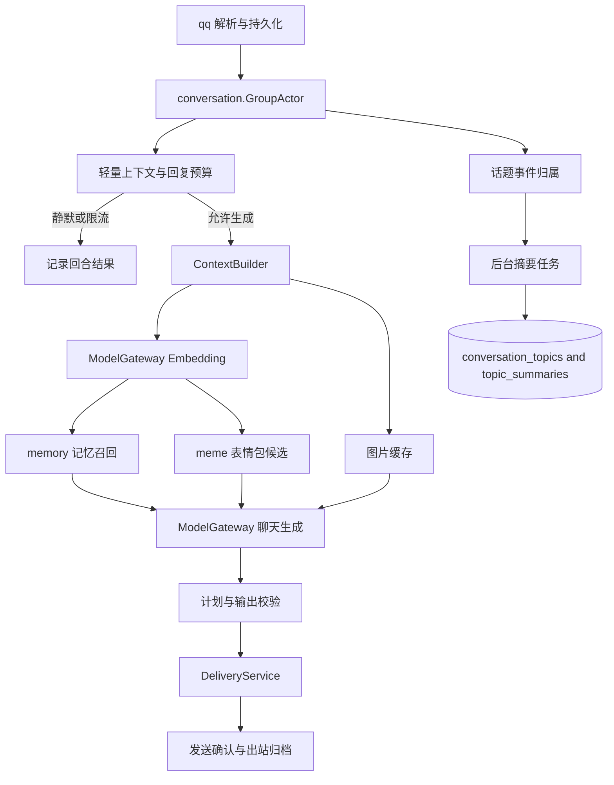

# 架构重构缺口整改说明

## 结论

当前实现已经具备按群排队、话题候选、共享 Embedding、记忆证据校验、全局表情包和发送状态保护。Go 单元测试、竞态测试、数据库集成测试、回放、静态检查和构建均已通过。

完整验收仍有七项缺口：话题摘要没有生成任务，重启后话题索引无法恢复，`ContextBuilder` 没有接入主链路，BM25 和多类缓存没有按目标 TTL 工作，回复预算检查发生在模型调用之后，模型底层仍使用共享并发槽位，结构化经历记忆和观测输出也没有落地。

本文件给出直接可实施的整改方案。实施过程不增加新旧召回对比开关，完成后直接使用目标链路。

## 阅读方式与范围

本文使用三类标记：

- **当前事实**：可以在当前源码或已执行的测试命令中核对。
- **整改要求**：本次需要实现的目标行为。
- **验收条件**：完成后必须能够通过的检查。

本文覆盖以下源码范围：

- 会话与回合：`internal/chat`、`internal/conversation`、`internal/context`、`internal/policy`、`internal/delivery`
- 记忆与检索：`internal/memory`、`internal/search`
- 缓存与模型：`internal/cache`、`internal/model`
- 话题和素材持久化：`internal/store`、`schema/schema.sql`、`internal/meme`
- 组装和后台任务：`internal/app`

本文不调整 OneBot 协议、后台页面功能、模型供应商选择和 QQ 发送协议。

## 缺口对照

| 编号 | 当前事实 | 整改目标 | 影响 |
| --- | --- | --- | --- |
| G1 | `SaveTopics` 会保存话题视图，但没有摘要生成任务；`Restore` 只恢复参与者和摘要文本，没有恢复事件归属和词面索引。[`chat.go:193`](../internal/chat/chat.go:193) [`topics.go:94`](../internal/chat/topics.go:94) | 持久化话题事件归属、摘要、版本和独立游标，重启后恢复索引并继续使用原话题 ID。 | 长期话题连续性不成立。 |
| G2 | Runtime 初始化 `ContextBuilder` 后仍在 `respond` 中直接调用 `prepareTurn`。[`chat.go:134`](../internal/chat/chat.go:134) [`chat.go:469`](../internal/chat/chat.go:469) | 由一个上下文构建入口生成不可变快照，记忆、表情包、图片和模型共享同一查询资源。 | 接口存在但主链路无法替换和验证。 |
| G3 | `memory.recall` 每轮构建 BM25 文档；`RecallTTL`、`ContextTTL` 没有进入服务；图片没有缓存；表情包版本号固定为零。[`memory.go:224`](../internal/memory/memory.go:224) [`turn.go:97`](../internal/chat/turn.go:97) [`meme.go:106`](../internal/meme/meme.go:106) | 缓存索引、召回、上下文、Embedding、图片和表情包候选，并按版本和配置 TTL 失效。 | CPU、数据库和媒体请求仍有重复消耗。 |
| G4 | `ResponsePolicy` 接收的 `WithinBudget` 固定为 `true`；回复频率限制在检索和模型生成之后才检查。[`chat.go:480`](../internal/chat/chat.go:480) [`turn.go:209`](../internal/chat/turn.go:209) | 在检索前读取发送预算，策略直接决定静默、限流或进入模型。 | 超额消息仍占用模型和 Embedding 容量。 |
| G5 | Gateway 有多组槽位，但底层 `model.Client` 仍通过一个 `slots` 限制聊天、视觉、Embedding 和后台请求。[`app.go:51`](../internal/app/app.go:51) [`client.go:63`](../internal/model/client.go:63) | 底层请求池按聊天、视觉、Embedding、后台独立隔离，后台不能占用直接互动的保留容量。 | 后台索引可能延迟直接 @。 |
| G6 | `Episode` 只有内存类型；notes 表没有 `topic_id`；`valid_from` 和 `valid_to` 没有参与召回过滤。[`memory.go:47`](../internal/memory/memory.go:47) [`schema.sql:29`](../schema/schema.sql:29) [`memory.go:230`](../internal/memory/memory.go:230) | 经历记忆关联话题并进入独立预算，时间有效性和重要性参与召回。 | 长期记忆仍然主要是扁平事实笔记。 |
| G7 | `Gateway.Observe` 没有在应用组装时配置，命中率、延迟和模型请求没有结构化输出。[`gateway.go:73`](../internal/model/gateway.go:73) [`app.go:51`](../internal/app/app.go:51) | 每次请求都输出可关联的 group、attempt、版本、缓存和耗时字段。 | 无法建立真人感和缓存收益的运行基线。 |

## 目标主链路

整改后的每个回合按以下顺序执行：



`Admission` 只读取历史尾部、话题关系和发送预算，不调用模型。`ContextBuilder` 只为允许生成的回合执行一次完整组装。`ModelGateway` 为记忆、表情包和聊天共享同一个查询 Embedding。后台摘要、向量索引和表情包处理使用后台请求池。

## G1：补齐话题持久化和重启恢复

### 当前事实

`topicTracker.Snapshot` 只输出话题 ID、参与者、序号、状态和摘要。`Restore` 创建的 `topicState` 没有 `eventIDs`、`textEventIDs`、`texts`、`eventTopics` 和 `messageTopics`。恢复后，`observe` 无法沿用之前的引用链和 BM25 文本索引。[`topics.go:79`](../internal/chat/topics.go:79) [`topics.go:94`](../internal/chat/topics.go:94)

`topicState.revision` 只在零值时设置为 1，后续触碰话题不会递增。当前源码也没有为 `summary` 赋值的任务。[`topics.go:385`](../internal/chat/topics.go:385)

应用后台只启动记忆学习、使用统计和表情包任务，没有启动话题摘要任务。[`app.go:101`](../internal/app/app.go:101)

### 数据模型

在 `schema/schema.sql` 增加话题事件归属表：

```sql
CREATE TABLE IF NOT EXISTS groupfriend.conversation_topic_events (
  group_id BIGINT NOT NULL,
  topic_id TEXT NOT NULL,
  event_id TEXT NOT NULL,
  message_id TEXT NOT NULL DEFAULT '',
  seq BIGINT NOT NULL,
  assigned_at TIMESTAMPTZ NOT NULL,
  PRIMARY KEY(group_id, topic_id, event_id)
);
CREATE INDEX IF NOT EXISTS friend_topic_events_recent
  ON groupfriend.conversation_topic_events(group_id, seq DESC);
```

事件归属表只保留每个群最近 `maxTopicAssignments` 条记录。清理动作与保存话题视图使用同一个事务，避免恢复时读到不一致的 topic 和 event 数据。

`conversation_topics` 继续保存当前状态、参与者、序号、版本和最后活跃时间。`topic_summaries` 保存摘要版本、摘要文本、证据事件 ID 和摘要覆盖的最大序号。

### 接口调整

在 `internal/conversation` 增加持久化所需的数据结构：

```go
type TopicEventView struct {
    TopicID     string
    EventID     string
    MessageID   string
    Seq         int64
    AssignedAt  time.Time
    TopicIDs    []string
}

type TopicSummary struct {
    GroupID       int64
    TopicID       string
    Revision      int64
    Summary       string
    EvidenceIDs   []string
    SourceSeq     int64
    UpdatedAt     time.Time
}
```

扩展 `topicStore`：

```go
type topicStore interface {
    LoadTopics(context.Context, int64) ([]conversation.TopicView, error)
    LoadTopicEvents(context.Context, int64, int64) ([]conversation.TopicEventView, error)
    SaveTopics(context.Context, int64, []conversation.TopicView, []conversation.TopicEventView, int64) error
    LoadSummaryProgress(context.Context, int64) (int64, error)
    SaveTopicSummary(context.Context, conversation.TopicSummary, int64) error
}
```

`SaveTopics` 必须使用事务完成以下动作：

1. 更新或插入 `conversation_topics`。
2. 更新当前窗口内的 `conversation_topic_events`。
3. 写入非空的 `topic_summaries`。
4. 只在前面三项全部成功后推进 `summary_after_seq`。

### 恢复流程

创建群 Actor 时按以下顺序恢复：

1. 读取最近活跃话题。
2. 读取这些话题对应的最近事件归属。
3. 通过事件归属重建 `eventTopics`、`messageTopics`、`eventMessageIDs` 和每个 topic 的文本窗口。
4. 将 `nextID` 设置为已恢复 topic ID 中的最大序号加一。
5. 读取消息表中大于已恢复最大序号的事件，再交给 Actor 处理。

恢复失败时，聊天继续使用近期消息和词法召回，但必须把 `topic_restore` 写入降级字段，并且不能覆盖数据库中的有效状态。

### 摘要任务

新增 `internal/conversation/summarizer.go` 或同职责文件，实现 `TopicSummarizer.Tick`：

- 读取每个群 `summary_after_seq` 之后的已持久化消息。
- 按当前 topic 归属分组，每组最多处理 `SummaryBatch` 条事件。
- 使用 `model.Background(ctx)` 调用模型。
- 只保存结构化摘要、证据事件 ID、topic revision 和 source sequence。
- 模型失败、解析失败或写库失败时只更新 `retry_at`，不推进游标。
- 成功提交后才推进独立摘要游标。

将任务注册到 `internal/app/app.go`：

```go
runBackground(a.ctx, &a.wg, a.cfg.Memory.SummaryInterval, a.topics.Tick)
```

### 验收条件

- 同一群重启后，最近活跃 topic ID 不变。
- 恢复后的引用消息能继续命中原 topic。
- 恢复后的词面消息能使用摘要和最近事件参与候选排序。
- 新 topic ID 不覆盖已恢复的 topic ID。
- 摘要生成失败不推进摘要游标，也不阻塞聊天回合。
- 两个群的 topic、事件归属和摘要不会互相读取。

## G2：接入 ContextBuilder 并冻结回合快照

### 当前事实

`internal/context.ContextSnapshot` 已定义历史、批次、话题、笔记、表情包、图片和 Embedding 字段，但 `SnapshotBuilder` 没有填充图片和参与者，且 `StickerAssets` 只复制了切片，没有复制内部 `Tags`。Runtime 主流程没有调用它。[`builder.go:18`](../internal/context/builder.go:18) [`builder.go:49`](../internal/context/builder.go:49)

### 接口调整

将 `chat.ConversationContext`、`ConversationEvent` 和 `ConversationTopic` 移到 `internal/conversation`，分别命名为 `conversation.Context`、`conversation.Event` 和 `conversation.Topic`。这样 `internal/context` 可以引用关系类型，而不需要依赖 `internal/chat`，避免形成循环依赖。

将上下文构建拆成轻量准入上下文和完整回合快照：

```go
type AdmissionSnapshot struct {
    GroupID       int64
    ActorVersion  uint64
    History       []qq.Event
    Batch         []qq.Event
    Conversation  conversation.Context
    Query         string
}

type AdmissionBuilder interface {
    Build(context.Context, int64, uint64, []qq.Event) (AdmissionSnapshot, error)
}

type Builder interface {
    Build(context.Context, AdmissionSnapshot) (ContextSnapshot, error)
}
```

`AdmissionBuilder` 只读取历史和话题图，不做记忆召回、表情包召回、图片下载和 Embedding。`Builder` 只对已准入回合执行完整资源组装。

### Runtime 调整

`Runtime.respond` 使用以下固定顺序：

1. 调用 `AdmissionBuilder`。
2. 调用 `Store.RepliesSince`，得到一分钟内确认回复数和最近回复时间。
3. 将真实预算传给 `ResponsePolicy`。
4. 静默或限流时直接结束回合。
5. 调用 `ContextBuilder` 一次。
6. 将同一个 `QueryEmbedding` 传给 memory 和 meme。
7. 生成、校验、发送和归档。

删除 `respond` 对 `prepareTurn` 的直接依赖。测试可以注入假的 `AdmissionBuilder` 和 `Builder`，验证主链路使用的是快照，而不是重新读取可变状态。

### 深拷贝要求

快照返回前必须复制以下所有可变成员：

- `qq.Event.Images`
- `conversation.TopicView.Participants`
- `memory.Note.Evidence`
- `meme.Asset.Tags`
- `QueryEmbedding`
- 图片数据字符串切片

### 验收条件

- 自定义 Builder 能够被 Runtime 实际调用。
- 一个回合只调用一次查询 Embedding。
- 修改 Builder 输入或返回值不会改变已生成快照。
- 图片下载失败只记录 `images` 降级，词法、上下文和近期消息仍可继续生成。
- memory、meme 和模型看到同一批次、同一历史和同一个查询向量。

## G3：接入完整缓存层

### 缓存配置

扩展 `config.Cache`：

```yaml
cache:
  max_items: 10000
  embedding_ttl: 30m
  index_ttl: 10m
  recall_ttl: 20s
  topic_ttl: 10s
  sticker_ttl: 20s
  image_ttl: 10m
  context_ttl: 10s
```

所有 TTL 都必须大于零，并受配置校验限制。业务服务不能自行写死默认 TTL。

### 缓存键

缓存键按以下规则生成：

| 数据 | 键必须包含 |
| --- | --- |
| Embedding | 模型版本、规范化文本哈希 |
| BM25 索引 | 群 ID、memory revision、索引版本 |
| 记忆召回 | 群 ID、Actor version、memory revision、Embedding model version、查询哈希 |
| 话题快照 | 群 ID、Actor version、topic revision |
| 表情包候选 | 群 ID、素材 revision、冷却时间片、Embedding model version、查询哈希 |
| 图片数据 | 图片 URL 或内容哈希、媒体处理版本 |
| 完整上下文 | 群 ID、Actor version、memory revision、topic revision、素材 revision |

缓存读取失败按 miss 处理。缓存写入失败只记录指标，不阻塞主链路。缓存返回值必须与调用者隔离。

### BM25 索引缓存

使用 `bm25.NewIndex` 生成不可变索引。`memory.Service` 增加 `IndexCache`，按 `NotesIndexKey` 读取索引。索引内容只包含当前群、当前 memory revision 和有效笔记。

`recall` 只负责分词和查询排序，不再每轮构建 `[]bm25.Document`。记忆修改后通过 revision 生成新键，旧索引自然失效。

### Recall 和 Context 缓存

`Runtime.retrieveTurn` 不再传入固定的 `20*time.Second`。它读取 `cfg.Cache.RecallTTL` 和 `cfg.Cache.ContextTTL`，并取得实际 memory revision、topic revision 和 asset revision。

缓存命中结果不能绕过发送前的素材可用性检查。表情包候选命中后，`Resolve` 仍然从存储读取最新状态和路径。

### 素材和图片 revision

新增 `StickerRevision(context.Context) (int64, error)`。素材新增、描述更新、禁用和淘汰都递增 revision。`meme.Service` 每次构建候选键前读取该 revision，不使用永远为零的成员字段。

新增 `ImageCache`，缓存 `qq.ImageData` 结果，不缓存无限增长的原始响应。单张图片和单回合图片数量继续受现有上限约束。

### 验收条件

- 同一文本和同一模型版本只产生一次底层 Embedding 请求。
- 同一 memory revision 下的重复查询命中索引和召回缓存。
- 记忆修改、topic 版本变化和素材状态变化都生成新键。
- 同一图片在 10 分钟内不会重复下载和转换。
- 达到容量上限时缓存淘汰，不阻塞事件接入。
- 缓存错误不会把普通聊天变成失败回合。

## G4：把回复预算前移到模型调用之前

### 策略输入

扩展 `policy.Input`：

```go
type Input struct {
    GroupID          int64
    Directed         bool
    Continuing       bool
    HasNewInfo       bool
    RepliesLastMinute int
    LastReplyAt      time.Time
    MaxPerMinute     int
    SpontaneousInterval time.Duration
}
```

策略按以下顺序判断：

1. 没有新信息且没有明确互动，返回 `silent`。
2. `RepliesLastMinute >= MaxPerMinute`，返回 `limited`。
3. 非直接互动且仍在自发回复间隔内，返回 `limited`。
4. 直接 @、回复机器人或活跃话题继续对话，允许生成。

`WithinBudget` 字段删除，避免调用方固定传入无效值。策略返回值需要包含 `DecisionSilent`、`DecisionDirect`、`DecisionContinuation`、`DecisionSpontaneous` 和 `DecisionLimited` 对应的原因码。

### Runtime 调整

将 `RepliesSince` 放到 `retrieveTurn` 之前。限流结果只创建并完成一个回合记录，不调用 Embedding、记忆召回、表情包召回或聊天模型。

发送前保留一次预算复核，防止等待模型期间其他回合已经消耗额度。复核只影响发送，不重新调用模型。

### 验收条件

- 已达到每分钟上限时，底层聊天模型调用次数为零。
- 普通插话处于间隔内时，底层 Embedding 和聊天模型调用次数为零。
- 直接 @ 不受普通插话间隔限制，但仍受每分钟总额限制。
- 已生成草稿在明确新互动到达后仍按现有规则失效。

## G5：隔离模型请求池

### 当前问题

Gateway 的 `ChatSlots`、`VisionSlots`、`EmbeddingSlots` 和 `BackgroundSlots` 只限制 Gateway 进入底层客户端的数量。`model.Client` 仍使用一个共享 `slots`，因此后台请求仍可能占用聊天容量。[`gateway.go:107`](../internal/model/gateway.go:107) [`client.go:76`](../internal/model/client.go:76)

### 实现方案

将 `model.Client` 的共享 `slots` 改成四组底层槽位：

```go
type requestKind uint8

const (
    requestChat requestKind = iota
    requestVision
    requestEmbedding
    requestBackground
)
```

`Generate` 根据是否包含图片选择聊天或视觉槽位。`Embed` 选择 Embedding 槽位。后台上下文只能选择后台槽位。Gateway 保留请求结构、缓存和观测职责，底层 Client 负责最后一层容量隔离。

后台请求等待自己的槽位时不能读取或占用聊天槽位。直接互动等待聊天槽位时不需要等待后台请求释放容量。

### 验收条件

- Embedding 并发达到上限时，聊天请求仍能获得聊天槽位。
- 后台索引持续堆积时，直接 @ 请求不被后台占满。
- 视觉请求只消耗视觉容量，不能占用普通聊天容量。
- 每个请求在等待槽位、调用供应商和返回结果时都遵守同一个 context deadline。

## G6：完成结构化经历记忆

### 数据模型

在 `groupfriend.notes` 增加：

```sql
ALTER TABLE groupfriend.notes
  ADD COLUMN IF NOT EXISTS topic_id TEXT NOT NULL DEFAULT '';
CREATE INDEX IF NOT EXISTS friend_notes_topic
  ON groupfriend.notes(group_id, topic_id, kind, state);
```

`memory.Note` 和 `memory.Change` 增加 `TopicID`。`kind='episode'` 时必须记录 topic ID，`preference` 和 `member` 可以为空。

### 召回顺序

每轮上下文按固定预算组装：

| 资料 | 数量上限 |
| --- | ---: |
| 当前批次 | 8 条 |
| 历史事件 | 24 条 |
| 当前话题摘要 | 4 条 |
| 成员资料 | 8 条 |
| 偏好和群事实 | 6 条 |
| 相关经历 | 6 条 |
| 表情包候选 | 5 个 |
| 图片 | 2 张 |

召回必须过滤：

- `state='active'`
- `expires_at` 未过期
- `valid_from` 为空或不晚于当前时间
- `valid_to` 为空或晚于当前时间
- note 所属 group 与当前群一致
- episode 的 topic ID 与当前可见话题匹配，或命中语义和词面相关性

排序顺序固定为明确偏好、成员资料、当前话题摘要、相关经历、语义事实。`salience`、`confidence`、`last_used_at` 和 `use_count` 只参与排序和统计，不改变证据校验规则。

### 记忆写入

交互式记忆仍要求明确请求和当前入站事件证据。后台学习可以处理持久化消息，但成员事实仍只能引用该成员本人消息。遗忘后的 event ID 继续进入阻断校验。

已确认召回的笔记通过内存计数聚合，按 `UsageFlushInterval` 批量写回 `last_used_at` 和 `use_count`。写回失败时保留内存中的待写数据。

### 验收条件

- 经历记忆能按 topic ID 在重启后恢复和召回。
- 已过 `valid_to` 的笔记不会进入上下文。
- 成员资料不会因为其他成员的评价被创建或升级。
- 遗忘后的旧证据无法通过更换 key 重新激活。
- 使用统计不会阻塞回复，也不会丢失失败批次。

## G7：接通结构化观测

### Gateway 观测

在 `internal/app` 创建 Gateway 时注入观测函数：

```go
gateway.Observe = func(o model.Observation) {
    attrs := []any{
        "operation", o.Operation,
        "group_id", o.GroupID,
        "attempt_id", o.AttemptID,
        "prompt_version", o.PromptVersion,
        "model_version", o.ModelVersion,
        "cache_hit", o.CacheHit,
        "duration_ms", o.Duration.Milliseconds(),
    }
    if o.Err != nil {
        attrs = append(attrs, "error", o.Err)
    }
    slog.Info("model request", attrs...)
}
```

正式实现可以接入现有指标系统，但必须保留以下字段：

- `operation`
- `group_id`
- `attempt_id`
- `prompt_version`
- `model_version`
- `cache_hit`
- `duration_ms`
- `input_tokens`
- `output_tokens`
- `error_class`

日志不能写入原始消息、Embedding 内容、API Key 或图片数据。

### 回合观测

在 `Attempt.Retrieval` 中继续保存各路检索 ID 和降级原因，并补充：

- `index_cache_hit`
- `recall_cache_hit`
- `topic_cache_hit`
- `image_cache_hit`
- `stale_reason`
- `policy_reason`

缓存命中率和模型延迟从统一观测出口计算，不从日志文本二次解析。

### 验收条件

- 每次聊天、视觉和 Embedding 请求都有 group、attempt 和版本字段。
- 缓存命中、miss、错误和耗时可以按 operation 聚合。
- 日志中没有用户消息正文、Embedding 原文、密钥和图片内容。
- 模型不可用时仍能看到降级轨道和最终回合状态。

## 文件级改造清单

| 文件或目录 | 具体动作 |
| --- | --- |
| `internal/chat/chat.go` | 使用 AdmissionBuilder、预算策略和 ContextBuilder，删除主链路对 `prepareTurn` 的直接调用。 |
| `internal/chat/turn.go` | 只消费快照，使用配置 TTL、真实 revision 和共享 Embedding，保留发送前预算复核。 |
| `internal/chat/topics.go` | 增加 topic revision、恢复索引、ID 续号、事件归属导出和摘要结果应用。 |
| `internal/conversation` | 增加 topic event、topic summary 和恢复所需的数据结构。 |
| `internal/context/builder.go` | 完善深拷贝、图片资源、参与者和话题摘要预算。 |
| `internal/policy/policy.go` | 接收真实发送预算，返回限流和互动原因码。 |
| `internal/memory/memory.go` | 使用不可变 BM25 索引缓存，接入 topic summary、episode、有效期和预算。 |
| `internal/meme/meme.go` | 使用数据库素材 revision、配置 TTL 和图片缓存。 |
| `internal/cache` | 增加带版本键的索引、上下文、图片和素材缓存能力，统一处理 miss 和统计。 |
| `internal/model/client.go` | 将底层共享槽位拆成聊天、视觉、Embedding 和后台四组。 |
| `internal/model/gateway.go` | 保留请求边界，补充实际缓存结果、模型版本和错误分类观测。 |
| `internal/store/store.go` | 增加 topic event、topic summary、素材 revision 和 episode 字段的事务读写。 |
| `schema/schema.sql` | 增加 topic event 表、episode 的 topic 字段和相关索引。 |
| `internal/app/app.go` | 组装真实 Builder、TopicSummarizer、配置 TTL、观测回调和后台摘要任务。 |
| `internal/replay` | 实现同样的 topic event、summary cursor、revision 和缓存行为。 |
| `configs/config.example.yaml` | 增加缓存、索引、摘要和模型并发配置示例。 |
| `docs/ARCHITECTURE.md` | 修正话题持久化、缓存和后台摘要的描述，使文档与实现一致。 |

## 实施顺序和提交边界

按以下顺序实施，每项完成后运行对应验证：

1. 话题事件归属、摘要任务和重启恢复。
2. AdmissionBuilder、ContextBuilder 主链路和深拷贝。
3. BM25、召回、上下文、图片和素材缓存。
4. 回复预算前移和底层模型并发隔离。
5. Episode 记忆、有效期过滤和使用统计。
6. 结构化观测、回放样例和文档同步。

每个提交只包含一个完整边界。提交前按仓库规则执行：

```bash
rtk git diff --cached --name-only
rtk go test ./...
rtk go test -race ./...
rtk go vet ./...
rtk go build ./...
rtk git diff --check
rtk proxy dcc doctor
```

只有 `dcc doctor` 确认 GitHooks 正常后才能提交。本文档和文档索引应放在最后一个文档提交中。

## 验收矩阵

| 验收项 | 验证方式 | 通过条件 |
| --- | --- | --- |
| 话题重启 | 持久化测试或独立 PostgreSQL 测试 | topic ID、参与者、引用关系和摘要可恢复。 |
| 摘要失败 | 注入模型错误 | 聊天继续，摘要游标不推进。 |
| 单次 Embedding | 计数 Embedding fake | 一个回合的 memory、meme 和模型路径最多一次底层调用。 |
| 索引复用 | 计数 BM25 构建器 | 同 revision 重复查询只构建一次。 |
| 缓存失效 | 修改 note、topic、sticker 后重复查询 | 新 revision 不能命中旧结果。 |
| 图片复用 | 计数 HTTP fake | 同 URL 在 TTL 内只下载一次。 |
| 策略前置 | 计数模型 fake | 限流回合不调用 Embedding 和聊天模型。 |
| 并发隔离 | 阻塞后台 fake，再发直接 @ | 直接 @ 不等待后台槽位。 |
| 结构化记忆 | 重启回放 | episode 按 topic 和有效期正确召回。 |
| 记忆使用统计 | 让写回失败后重试 | 失败批次保留并在下次任务继续写回。 |
| 观测字段 | 注入 Observation 收集器 | 每次模型请求包含规定字段和错误分类。 |
| 发送一致性 | OneBot 超时和归档失败 fake | 状态为 `unknown`，不自动补发，不写入虚假出站历史。 |

## 当前验证基线

以下命令已在当前工作树执行并通过：

```bash
rtk go test ./...
rtk go test -race ./...
rtk go vet ./...
rtk go build ./...
rtk proxy go test -v ./internal/store
rtk proxy go test -v ./internal/app
rtk go run ./cmd/replay -fixture tests/replay/conversation.json
rtk go run ./cmd/replay -fixture tests/replay/memory.json
```

这些结果证明当前边界和已有状态流转可运行。它们尚未证明本文列出的整改目标已经实现，尤其是重启恢复、后台摘要、缓存命中率、模型池隔离和真实模型表现。
