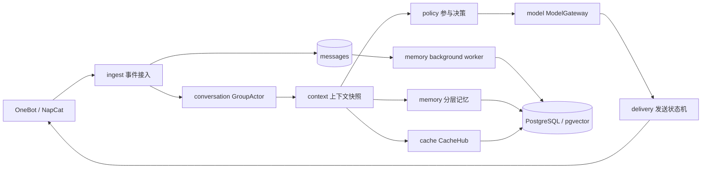

# 机器人架构重构实施方案

## 方案定位

本文是面向实现和评审的实施方案。目标是提升 go-agent 在 QQ 群中的互动自然度、记忆连续性和缓存利用率，同时保留当前的发送可靠性边界。

本文基于当前工作树中的实现和文档编写。当前程序是模块化单体，`internal/app` 负责组装，`internal/chat` 负责按群协调，`internal/memory` 负责记忆，`internal/store` 负责 PostgreSQL，`internal/model` 负责模型和 Embedding，见 [当前架构说明](ARCHITECTURE.md)。

本方案直接采用新的召回链路，不设计新旧链路双跑、结果对比或运行时切换开关。数据库迁移采用向后兼容的增量方式，代码按独立提交逐批落地。

## 目标和边界

### 目标

1. 让机器人根据当前话题、互动对象和最近行为决定是否接话，再生成自然表达。
2. 将记忆分成工作记忆、话题记忆、事实记忆和经历记忆，支持跨重启恢复重要上下文。
3. 缓存近期事件、话题快照、BM25 索引、Embedding、记忆召回和表情包候选。
4. 保留现有事件去重、发送状态、证据校验、遗忘保护、按群隔离和发送锁。
5. 为延迟、Token、缓存命中和记忆命中建立可观测指标。

### 不在本次范围内

- 不拆成多个微服务。
- 不引入通用 Agent 工具循环、电脑控制或本地任务执行。
- 不建立数值化的好感度、信任度或情绪分数。
- 不缓存最终自然语言回复的语义相似结果。
- 不改变 OneBot 协议适配和后台管理页的鉴权边界。

## 当前实现依据

当前聊天流程已经具备入站归档、按群合并、话题判断、模型输出校验和发送状态管理。`turnContext` 会把历史、当前批次、话题和查询文本冻结到一次回合中，见 [turn.go](/Users/admin/Desktop/go-agent/internal/chat/turn.go:18)。

当前长期记忆以 `notes` 为中心。每轮召回会读取本群最多 5,000 条笔记，再构建 BM25 文档；有查询时还会调用 Embedding 和向量检索，见 [memory.go](/Users/admin/Desktop/go-agent/internal/memory/memory.go:92)。

当前表情包候选也会独立执行词法和语义检索，见 [meme.go](/Users/admin/Desktop/go-agent/internal/meme/meme.go:79)。因此同一回合的记忆检索和表情包检索可能对同一 query 重复计算 Embedding。

当前模型客户端只缓存已经初始化的模型客户端，不缓存 Embedding、召回结果或上下文快照。主模型、视觉模型、Embedding 和后台任务共享全局并发槽位，见 [client.go](/Users/admin/Desktop/go-agent/internal/model/client.go:63)。

当前动态话题图只在进程内保存，重启后不会恢复。数据库已有 `messages`、`notes`、`stickers`、`reply_attempts` 和 `group_progress`，见 [schema.sql](/Users/admin/Desktop/go-agent/schema/schema.sql:4)。

## 总体设计

重构后仍采用一个 Go 进程，但把聊天流程拆成事件接入、群聊 Actor、上下文组装、参与决策、记忆检索、模型网关和发送状态机。



每个群对应一个 `GroupActor`。Actor 只负责串行化本群的短期状态更新，不持有数据库事务，也不持有模型请求期间的锁。模型请求、Embedding 和图片下载在 Actor 外执行，完成后通过版本号检查结果是否仍然有效。

一次回合的顺序固定为：

1. 解析 OneBot 事件并按平台事件 ID 去重。
2. 先写入 `messages`，再交给对应群的 Actor。
3. Actor 合并分条消息，更新话题候选和回合版本。
4. `ContextBuilder` 读取同一个版本的近期事件、话题摘要、成员资料和相关记忆。
5. `ResponsePolicy` 判断是否需要模型、允许的表达节奏和目标事件。
6. `ModelGateway` 生成结构化回复。
7. 程序校验目标事件、话题、引用、记忆证据和表情包候选。
8. `DeliveryService` 记录 `sending`，调用 OneBot，再以现有事务确认发送结果。
9. 成功发送后更新 Actor 的话题参与状态和缓存版本。

## 代码目录和职责

第一批重构先移动职责，不改变对外行为。建议目录如下：

```text
internal/
  ingest/
    service.go       # 事件解码、过滤、去重、归档
  conversation/
    actor.go         # 每群 GroupActor 和生命周期
    topic.go         # 话题候选、状态和版本
    turn.go          # 回合合并与失效判断
  context/
    builder.go       # ContextSnapshot 组装
    budget.go        # 字符、事件、图片和记忆预算
  policy/
    policy.go        # 是否参与、目标事件和 response_mode
  memory/
    recall.go        # 分层召回和结果融合
    profile.go       # 成员资料与群资料
    episode.go       # 话题经历和摘要
    worker.go        # 学习、摘要和索引任务
  cache/
    hub.go           # CacheHub 和缓存接口
    local.go         # 有界本地缓存
    keys.go          # 所有缓存键
  model/
    gateway.go       # ModelGateway
    embedding.go     # Embedding 缓存和请求合并
    client.go        # 各模型供应商适配
  delivery/
    service.go       # 发送前检查、发送和归档
  store/
    ...              # PostgreSQL 查询、事务和迁移
```

`internal/chat` 可以在第一批中保留为兼容入口，由它组装上述服务。第二批完成后，`chat.Runtime` 只保留接口组合和生命周期管理，避免继续堆积业务逻辑。

## 核心接口

### 群聊 Actor

```go
type GroupActor interface {
    Submit(context.Context, qq.Event) error
    Snapshot(context.Context) (conversation.Snapshot, error)
    Close()
}

type Snapshot struct {
    GroupID       int64
    Version       uint64
    LastSeq       int64
    ActiveTopicID string
    Topics        []TopicView
    Participants  []int64
    LastBotAt     time.Time
    Pending       []PendingQuestion
}
```

Actor 内部至少维护以下状态：

- `version`：每次新事件、撤回、确认发送或话题更新时递增。
- `lastSeq`：已纳入短期状态的消息序号。
- `activeTopicID`：最近仍活跃的话题。
- `topics`：有限数量的话题候选和参与者。
- `lastBotAt`：最近一次确认送达的机器人消息时间。
- `pending`：最近被机器人承接但尚未闭合的问题。

Actor 空闲回收时保存 `lastSeq` 和话题摘要到数据库，重新创建时先恢复摘要，再读取最近消息重建短期状态。

### 上下文快照

```go
type ContextSnapshot struct {
    GroupID       int64
    Version       uint64
    History       []qq.Event
    Batch         []qq.Event
    Topics        []conversation.TopicView
    Participants  []ParticipantProfile
    Notes         []memory.Note
    Episodes      []memory.Episode
    StickerAssets []meme.Asset
    Images        []string
    Query         string
}
```

快照必须是不可变值。检索完成后不修改快照内容，发送前只检查 Actor 版本是否仍与快照版本一致。

上下文预算建议如下：

| 内容 | 初始上限 | 处理规则 |
| --- | ---: | --- |
| 当前批次 | 8 条事件 | 保留作者、引用和撤回关系 |
| 原始近期消息 | 24 条事件 | 优先当前话题和最近机器人参与的话题 |
| 话题摘要 | 4 条 | 按话题相关度和最近活动排序 |
| 成员资料 | 8 条 | 只放当前批次涉及成员 |
| 事实和偏好 | 6 条 | 明确偏好优先 |
| 经历记忆 | 6 条 | 相关经历优先，保留来源 |
| 表情包候选 | 5 个 | 发送前再次检查文件和状态 |
| 图片 | 2 张 | 保持现有有界下载规则 |

这些上限先作为配置默认值。上线后根据 Token 和召回命中数据调整，不在第一批通过随机动态调节。

## 真人感设计

### 参与决策

`ResponsePolicy` 先执行确定性规则，再把结果交给模型。规则顺序如下：

1. 撤回事件不生成回复。
2. 明确 @、点名、回复机器人或引用机器人时进入高优先级候选。
3. 机器人最近参与的话题在活动窗口内，允许承接追问。
4. 群友之间的普通对话只有在机器人能补充新信息时才进入模型。
5. 当前批次已经被其他消息充分回答时，优先静默。
6. 同一群在短时间内连续生成过回复时，继续遵守每分钟预算。

策略层输出：

```go
type Decision struct {
    ShouldGenerate bool
    TargetEventID  string
    TopicID        string
    ResponseMode   string // silent, ack, short, answer, sticker
    Reason         string
}
```

模型输入只包含策略允许的目标事件和上下文。模型不能自行扩大可见范围，也不能改变目标群、目标话题或发送预算。

### 表达规则

保留当前一次结构化生成，不增加默认的“规划模型 + 文案模型”双调用。生成结果继续使用 JSON 校验，但增加以下字段：

```json
{
  "action": "silent|text|sticker",
  "plan": {
    "target_event_id": "event-id",
    "topic_id": "topic-id",
    "response_mode": "ack|short|answer|sticker"
  },
  "text": "",
  "quote": "",
  "sticker_id": "",
  "reason": "",
  "memory": []
}
```

提示词增加以下行为约束：

- 先承接当前消息，再决定是否补充背景。
- 不重复已经出现的结论。
- 不为了维持存在感而追问。
- 有明确记忆时自然引用事实，不宣布“我记得”。
- 只在当前话题相关时调用经历记忆。
- 情绪表达优先短句，不自动总结和提供清单。
- 不能编造线下经历、实时信息或群聊之外的背景。

## 分层记忆设计

### 工作记忆

工作记忆只保存在 Actor 和 `ContextSnapshot` 中，包含当前批次、近期事件、话题候选、最近机器人行为和待回复问题。它不调用模型，不写数据库。

### 话题记忆

新增 `conversation_topics` 和 `topic_summaries` 两类数据。话题摘要由以下字段组成：

```text
group_id
topic_id
summary
participants
first_seq
last_seq
status
revision
last_active_at
embedding
embedding_model
```

摘要触发条件：

- 话题累计新增 8 条有效事件。
- 话题从 `active` 进入 `warm`。
- 机器人确认发送后话题仍有未闭合问题。
- 进程关闭前存在未保存的话题状态。

摘要任务只处理持久化消息和已确认出站消息。摘要失败时保留原消息，不推进摘要游标。

### 事实记忆

保留现有 `notes` 表和证据校验。新增字段：

```text
salience       SMALLINT NOT NULL DEFAULT 50
confidence     REAL NOT NULL DEFAULT 1
last_used_at   TIMESTAMPTZ
use_count      BIGINT NOT NULL DEFAULT 0
valid_from     TIMESTAMPTZ
valid_to       TIMESTAMPTZ
memory_revision BIGINT NOT NULL DEFAULT 1
```

记忆更新规则：

- 用户明确要求记住、纠正或遗忘时，沿用当前交互式证据校验。
- 后台学习只提交有原始事件证据的事实。
- 同一 `subject + kind + key` 更新原记录，不创建冲突副本。
- 遗忘记录保留来源阻断信息，旧事件不能重新激活事实。
- 每次成功选入上下文后异步增加 `use_count` 和 `last_used_at`，失败不影响聊天主链路。

### 经历记忆

经历记忆记录一次可复用的事件，而不是把所有聊天都变成事实：

```text
id
group_id
topic_id
subject_ids
summary
evidence
occurred_at
source_seq
state
revision
embedding
embedding_model
```

例如“某成员上周解决了显示器故障”适合作为经历；“某成员喜欢某游戏”应进入事实或偏好。模型不能把经历自动升级为稳定事实。

## Cache Hub 设计

### 缓存接口

```go
type CacheHub interface {
    Get(key string, dst any) bool
    Set(key string, value any, ttl time.Duration)
    Delete(key string)
    Do(ctx context.Context, key string, fn func(context.Context) (any, error)) (any, error)
}
```

`Do` 使用 `singleflight` 合并相同键的并发计算。缓存容量必须有上限，超过容量按访问频率和最近使用时间回收。缓存值不得持有数据库连接、请求上下文或可变切片引用。

### 缓存层次

| 缓存 | 键组成 | 默认 TTL | 失效条件 |
| --- | --- | ---: | --- |
| Embedding | 模型版本、文本规范化哈希 | 30 分钟 | 模型版本变化 |
| 群笔记索引 | 群 ID、`memory_revision` | 10 分钟 | 笔记增删改、过期清理 |
| 记忆召回 | 群 ID、query 哈希、记忆版本、Actor 版本 | 20 秒 | 新消息、记忆变化、话题变化 |
| 话题快照 | 群 ID、Actor 版本 | 10 秒 | 新消息、撤回、确认发送 |
| 表情包候选 | 群 ID、query 哈希、素材版本、冷却时间片 | 20 秒 | 素材状态变化、确认发送 |
| 图片内容 | 图片 URL 或内容哈希 | 10 分钟 | 下载失败、大小超过限制 |

### 缓存键

统一由 `internal/cache/keys.go` 生成，不允许业务包手写字符串。示例：

```text
embed:v3:{model_version}:{text_hash}
notes-index:{group_id}:{memory_revision}
recall:{group_id}:{actor_version}:{memory_revision}:{query_hash}
topic-snapshot:{group_id}:{actor_version}
stickers:{group_id}:{asset_revision}:{cooldown_epoch}:{query_hash}
```

所有缓存键都必须包含群 ID 或明确声明为全局键。跨群表情包只共享内容描述和向量，不共享群冷却结果。

### 缓存失效

采用版本失效，不做全量删除：

- 每群维护 `actor_version`。
- 每群维护 `memory_revision`。
- 全局素材维护 `asset_revision`。
- Persona、Embedding 和 Prompt 版本进入模型上下文版本。

新事件只递增 Actor 版本。记忆提交成功后递增记忆版本。素材状态或确认发送变化后递增素材版本。旧缓存即使仍在内存中，也因版本不匹配而不可用。

### Redis 使用条件

第一阶段只实现进程内缓存。当前发送所有权由数据库 advisory lock 限制为单实例，见 [store.go](/Users/admin/Desktop/go-agent/internal/store/store.go:40)，因此本地缓存不会产生多实例一致性问题。

只有在明确需要多个运行实例同时提供读取或多个聊天进程共享热数据时，才把 `CacheHub` 的实现替换为 Redis。接口和缓存键不因存储介质变化。

## ModelGateway 设计

把当前 `model.Client` 包装成 `ModelGateway`，统一管理模型和 Embedding：

```go
type GenerateRequest struct {
    PromptVersion string
    PersonaVersion string
    System        string
    Input         any
    Images        []string
    Priority      Priority
}

type EmbedRequest struct {
    ModelVersion string
    Text         string
    Priority     Priority
}
```

网关职责：

1. 使用独立的聊天、视觉、Embedding 和后台信号量。
2. 先查 Embedding 缓存，再通过 `singleflight` 合并请求。
3. 主链路优先于后台整理和索引。
4. 记录请求耗时、Token、错误类型、模型版本和缓存命中。
5. 对 Embedding 失败提供词法和上下文召回降级。
6. 对模型失败返回明确错误，不生成模板化假回复。

同一回合的记忆检索和表情包检索共享 `QueryEmbedding`，由 `ContextBuilder` 计算一次，再传给两个服务。这样可以消除当前两个服务对同一 query 的重复 Embedding。

## 数据库迁移

迁移必须是增量的。启动时继续使用 `store.Initialize`，但把新表和新增字段拆成有序迁移文件，避免把全部结构继续塞在一个不可追踪的模板中。

### 新增表

```sql
CREATE TABLE groupfriend.conversation_topics (
  group_id BIGINT NOT NULL,
  topic_id TEXT NOT NULL,
  status TEXT NOT NULL,
  participants JSONB NOT NULL DEFAULT '[]',
  first_seq BIGINT NOT NULL,
  last_seq BIGINT NOT NULL,
  revision BIGINT NOT NULL DEFAULT 1,
  last_active_at TIMESTAMPTZ NOT NULL,
  PRIMARY KEY (group_id, topic_id)
);

CREATE TABLE groupfriend.topic_summaries (
  group_id BIGINT NOT NULL,
  topic_id TEXT NOT NULL,
  revision BIGINT NOT NULL,
  summary TEXT NOT NULL,
  evidence JSONB NOT NULL,
  source_seq BIGINT NOT NULL,
  embedding halfvec(__DIM__),
  embedding_model TEXT NOT NULL DEFAULT '',
  updated_at TIMESTAMPTZ NOT NULL,
  PRIMARY KEY (group_id, topic_id, revision)
);

CREATE INDEX friend_topic_summary_scope
  ON groupfriend.topic_summaries(group_id, topic_id, revision DESC);
```

经历记忆可以先复用 `notes` 的 `kind='episode'`，等摘要字段和使用统计稳定后再拆出独立表。第一版不新增另一套事实写入协议，避免同时维护两套证据和遗忘规则。

### 现有表修改

为 `notes` 增加 `salience`、`confidence`、`last_used_at`、`use_count`、`valid_from`、`valid_to` 和 `memory_revision`。为 `group_progress` 增加独立的摘要游标，避免摘要任务复用记忆学习游标。

迁移顺序：

1. 创建新表和新增列，所有新列提供默认值。
2. 发布支持旧数据的存储代码。
3. 启动时按最近消息重建话题摘要。
4. 摘要任务从新游标开始处理，不回写历史事实。
5. 验证稳定后再删除不再使用的旧字段或旧查询。

## 并发、失效和异常处理

### Actor 并发

- 同一群的事件入队、版本递增和短期状态更新串行执行。
- 不同群的 Actor 并行执行。
- Actor 不持有模型、数据库或网络锁。
- 模型返回后必须检查 `actor_version`。
- 版本过期的结果记录为 `stale`，不发送、不写入机器人参与状态。

### 记忆并发

- 记忆更新继续使用群级事务锁和 revision 条件更新。
- 记忆索引写入必须同时检查 `revision`、`state` 和 `embedding_model`。
- 记忆摘要失败只推进重试时间，不推进摘要游标。
- `last_used_at` 和 `use_count` 使用异步批量更新，不能阻塞主回复。

### 发送一致性

保留当前 `reply_attempts` 状态：`planning`、`sending`、`confirmed`、`unknown`、`failed`、`stale`。发送前仍然先写 `sending`，OneBot 成功后再和出站消息一起确认。网络超时或归档失败继续进入 `unknown`，不自动补发。

### 缓存异常

- 缓存读取失败按 miss 处理。
- 缓存写入失败只记录指标，不影响数据库和模型主链路。
- 版本不匹配按 miss 处理，不尝试修改旧值。
- 本地缓存达到上限时淘汰低频值，不阻塞事件接入。

## 实施顺序

### 第一批：抽取边界

改动范围：

- 从 `internal/chat/chat.go` 抽出 `GroupActor`。
- 从 `internal/chat/turn.go` 抽出 `ContextBuilder`、`ResponsePolicy` 和 `DeliveryService`。
- 把现有 `Attempt`、`ReplyPlan`、`turnContext` 迁移到对应包。
- 保留现有 Prompt、数据库表和发送状态。

验收：

- 现有 Go 测试、竞态测试和回放全部通过。
- 普通新消息不取消在途回答。
- 明确互动仍能使旧草稿失效。
- 发送状态和关闭等待行为不变。

### 第二批：Cache Hub 和共享 Embedding

改动范围：

- 新增 `internal/cache`。
- 新增本地有界缓存和 `singleflight`。
- 将 Embedding 缓存放入 `ModelGateway`。
- `ContextBuilder` 只生成一次 `QueryEmbedding`。
- `memory` 和 `meme` 接收共享向量，不再各自调用 Embedding。
- 为缓存命中、miss、淘汰和计算耗时增加指标。

验收：

- 相同回合只产生一次 query Embedding 请求。
- 相同群在短时间重复 query 可以命中召回缓存。
- 新事件、记忆修改和素材发送后旧版本缓存不可用。
- 缓存读写失败不影响正常回复。

### 第三批：记忆索引和话题持久化

改动范围：

- 新增 `conversation_topics` 和 `topic_summaries`。
- 将群内 BM25 文档构建结果缓存到 `MemoryIndexCache`。
- Actor 回收前保存话题状态。
- 启动时恢复最近话题摘要，再用近期消息补齐短期状态。
- 后台增加话题摘要任务和独立游标。

验收：

- 进程重启后，机器人能够恢复最近活跃话题的参与者和摘要。
- 话题摘要不跨群读取。
- 摘要生成失败不阻塞聊天，不推进错误游标。
- 记忆召回不再每轮重新加载并解析全部笔记。

### 第四批：事实和经历记忆

改动范围：

- 为 `notes` 增加重要性、可信度和使用统计。
- 将 `episode` 记忆与话题摘要关联。
- 召回顺序改为：明确偏好、成员资料、当前话题摘要、相关经历、语义事实。
- 将记忆使用统计异步批量写入。
- 更新 Prompt，限制记忆引用方式和事实升级条件。

验收：

- 明确称呼和偏好仍然优先返回。
- 转述不会被当成成员事实。
- 遗忘后的旧证据不能重新激活记忆。
- 相关经历能在重启后被召回。

### 第五批：模型网关和观测

改动范围：

- 拆分聊天、视觉、Embedding 和后台并发预算。
- 增加 `ModelGateway` 请求结构和版本字段。
- 增加结构化日志和指标。
- 后台任务使用独立优先级，不抢占主聊天请求。

验收：

- 后台索引堆积不会阻塞直接 @ 回复。
- 所有模型请求都能关联 group、attempt、prompt version 和 cache result。
- 模型不可用时仍保留词法、上下文和近期消息降级路径。

## 配置调整

在现有配置基础上增加以下字段：

```yaml
cache:
  max_items: 10000
  embedding_ttl: 30m
  recall_ttl: 20s
  context_ttl: 10s

memory:
  top_k: 6
  index_limit: 5000
  summary_batch: 8
  summary_interval: 30s
  usage_flush_interval: 30s

model_concurrency:
  chat: 2
  vision: 1
  embedding: 2
  background: 1
```

旧的 `model_concurrency` 在迁移代码中作为 `chat` 的默认值读取，完成配置迁移后再删除旧字段。缓存容量和 TTL 必须有上限，不能允许配置为无限。

## 测试和验证

### 单元测试

- Actor 的版本递增、空闲回收和重建。
- 话题摘要的合并、冲突和过期。
- 缓存键包含群 ID、模型版本和记忆版本。
- `singleflight` 能合并相同 Embedding 请求。
- 版本变化后旧召回和上下文缓存不能命中。
- 记忆引用仍然检查来源事件和群范围。

### 集成测试

- 多群并行处理时缓存不能串群。
- 记忆更新和召回并发时不返回旧 revision。
- 表情包发送后对应群的候选缓存失效，其他群仍可使用同一素材。
- 进程重启后能够从数据库恢复话题摘要。
- OneBot 超时仍保留 `unknown`，不自动补发。

### 回放样例

新增以下回放：

1. 同一话题跨进程重启继续追问。
2. 两个并行话题交错输入，机器人只承接被点名的话题。
3. 同一 query 同时触发记忆和表情包检索，只产生一次 Embedding。
4. 明确遗忘后旧话题摘要不能重新带出已遗忘事实。
5. 记忆服务故障时仍使用近期对话完成回复。

### 运行指标

上线前先记录基线，再检查以下指标：

- `chat_turn_latency_ms`：回合总耗时。
- `model_request_latency_ms`：模型请求耗时。
- `embedding_cache_hit_ratio`：Embedding 缓存命中率。
- `recall_cache_hit_ratio`：记忆召回缓存命中率。
- `context_cache_hit_ratio`：上下文快照命中率。
- `prompt_tokens_per_turn`：每轮输入 Token。
- `memory_selected_useful_ratio`：被选入上下文且被回复引用的记忆比例。
- `direct_reply_ratio`：明确互动的回复比例。
- `irrelevant_reply_ratio`：人工抽样确认的无关回复比例。
- `stale_attempt_ratio`：因新消息失效的模型结果比例。

在没有真实群聊样本前，不预先承诺自然度提升百分比。先用回放和目标群人工抽样建立基线，再确定验收阈值。

## 发布和回滚

所有数据库改动采用向后兼容方式，先加表和列，再发布读写代码。每一批代码都保持可以独立构建和测试。

回滚按最后一个完整批次执行：

1. 停止新版本进程，确保旧版本发送锁可获得。
2. 回退应用代码到上一批次提交。
3. 保留新增表和列，旧版本忽略未知结构。
4. 不删除新生成的摘要和缓存文件。
5. 修复数据后从对应游标重新启动后台任务。

不使用新旧召回对比开关。需要撤回时直接回退代码批次，避免两套召回结果长期并存。

## 完成标准

重构完成需要同时满足以下条件：

- `GroupActor`、`ContextBuilder`、`ResponsePolicy`、`ModelGateway` 和 `DeliveryService` 有独立接口和测试。
- 记忆和表情包检索共享一次 query Embedding。
- BM25 索引、召回结果、上下文快照和表情包候选具备有界缓存。
- 所有缓存键包含必要的群、版本和模型信息。
- 话题摘要能持久化并在重启后恢复。
- 发送、撤回、遗忘、证据校验和发送锁行为保持正确。
- `make check`、回放、数据库测试和竞态测试通过。
- 真实模型回放和目标群人工抽样完成，并记录延迟、Token、缓存命中和无关回复结果。
