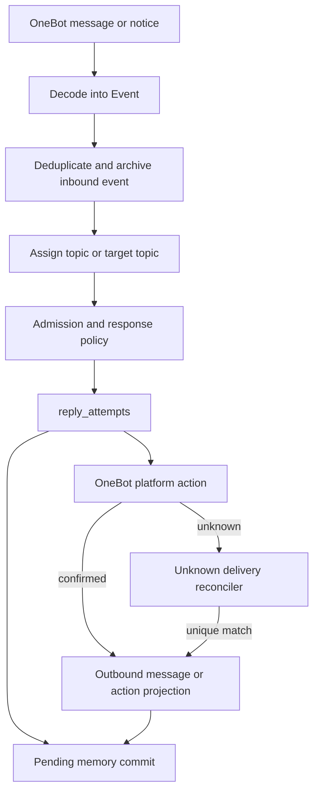

# 交互动作与发送一致性改造方案

## 结论

本方案补齐四条链路：平台动作的 topic 参与与咨询记录、出站 `unknown` 对账、记忆变更延后提交、入站 poke 与 reaction 事件。机器人 reaction 到自己消息继续沿用现有行为，不增加额外限制。

平台动作仍然不是聊天消息。动作确认后可以产生动作记录、topic 投影和笔记咨询记录，但不生成虚假的出站文本事件。这样可以让后续消息知道机器人参与过相关话题，同时避免摘要、记忆学习和 `repliesToBot` 把动作误判成文字回复。

出站发送仍然不自动补发。`unknown` 只进入可重试的本地对账流程。只有平台查询能够唯一确认原消息时，程序才补写出站归档并完成后续投影。

## 现状依据

以下结论来自当前工作区源码，属于改造前事实：

- reaction 和 poke 在平台调用成功后只更新 attempt 状态，不写 `messages`、topic participation 或 `note_usage`。[`internal/chat/turn.go:187-203`](../internal/chat/turn.go#L187-L203)
- 普通文字和表情包通过 `FinishAttempt` 同时确认 attempt、写出站消息和写笔记 usage。[`internal/chat/turn.go:205-227`](../internal/chat/turn.go#L205-L227)、[`internal/store/store.go:241-297`](../internal/store/store.go#L241-L297)
- `repliesToBot` 只通过已归档的 outbound 消息判断引用关系。[`internal/chat/social.go:143-153`](../internal/chat/social.go#L143-L153)
- `botParticipated` 和 `botAt` 目前只存在内存 topic 图。`TopicView`、`conversation_topics` 和 topic restore 流程没有保存这两个字段。[`internal/chat/topics.go:49-65`](../internal/chat/topics.go#L49-L65)、[`internal/chat/topics.go:148-189`](../internal/chat/topics.go#L148-L189)、[`schema/schema.sql:54-58`](../schema/schema.sql#L54-L58)
- `Decode` 目前只接收群消息和群撤回，其他 notice 会被忽略。[`internal/qq/qq.go:66-114`](../internal/qq/qq.go#L66-L114)
- 记忆变更在发送前调用 `memory.Service.Apply`，`Apply` 最终直接提交 `SaveNotes`。[`internal/chat/turn.go:73-87`](../internal/chat/turn.go#L73-L87)、[`internal/memory/memory.go:682-885`](../internal/memory/memory.go#L682-L885)

## 目标与边界

目标如下：

1. 已确认的 reaction 和 poke 能够留下独立的动作事实，并可以参与后续 topic continuation 判断。
2. 已确认动作可以记录“咨询过的笔记”，但不改变现有 `notes.use_count` 的文字回复语义。
3. 出站归档失败时，程序可以利用已保存的发送凭据对账，且不重复发送。
4. 发送未知或失败时，不提交本轮待确认的记忆变更。
5. bot 能感知入站 poke 和 reaction，并把它们作为无文本的独立事件交给策略层。

范围外内容如下：

- 不为机器人 reaction 自己的消息增加额外限制，现有可见性校验继续生效。
- 不把 reaction 或 poke 伪造成普通文本。
- 不为动作增加自动文字降级。
- 不通过相似文本猜测 `unknown` 对应的出站消息。
- 不将 action-only 事件作为摘要和长期记忆的文字证据。

## 总体模型

消息、平台动作和动作通知使用同一个入站归档边界，但采用不同事件类型。



普通消息归档到 `messages`，动作归档到动作表或动作投影，入站通知归档到 `messages` 的事件类型字段。只有普通消息和表情包出站事件进入 `repliesToBot` 的消息引用判断。

## 平台动作的 topic 与笔记语义

### Topic 参与

增加两类时间字段：

```text
bot_message_at  机器人最近一次发送消息的时间
bot_action_at   机器人最近一次确认 reaction 或 poke 的时间
```

字段同时加入 `conversation.TopicView` 和 `conversation_topics`。`botParticipated` 可以保留为兼容字段，也可以由两个时间字段派生。推荐在上下文中继续暴露 `bot_participated`，同时增加 `bot_action_participated`，让模型知道参与来源。

动作确认后执行以下步骤：

1. 从 reaction 的引用消息或 poke 的目标事件取得 topic ID。
2. 将 `(attempt_id, action_kind, target_event_id, topic_id, confirmed_at)` 写入 `conversation_topic_actions`。
3. 更新 topic 的 `bot_action_at` 和 `last_active_at`。
4. 在动作确认后让 topic tracker 重新载入或应用同一投影。

建议的动作表如下：

```sql
CREATE TABLE groupfriend.conversation_topic_actions (
  attempt_id TEXT NOT NULL,
  group_id BIGINT NOT NULL,
  topic_id TEXT NOT NULL,
  action_kind TEXT NOT NULL,
  target_event_id TEXT NOT NULL DEFAULT '',
  target_message_id TEXT NOT NULL DEFAULT '',
  confirmed_at TIMESTAMPTZ NOT NULL,
  PRIMARY KEY (attempt_id, topic_id, action_kind)
);
```

topic continuation 在活动窗口内同时检查 `bot_message_at` 和 `bot_action_at`。动作仍然保持独立事件类型，因此后续可以只关闭 action continuation，而不删除动作事实。

动作没有可确定的 topic 时只确认动作，不更新 topic。程序不使用“最近活跃 topic”猜测动作归属。

### 笔记咨询

现有 `note_usage` 和 `notes.use_count` 继续表示成功文字回复使用过的笔记。动作确认后新增独立的 `note_consultation` 账本：

```sql
CREATE TABLE groupfriend.note_consultation (
  attempt_id TEXT NOT NULL,
  note_id TEXT NOT NULL,
  group_id BIGINT NOT NULL,
  action_kind TEXT NOT NULL,
  confirmed_at TIMESTAMPTZ NOT NULL,
  PRIMARY KEY (attempt_id, note_id)
);
```

写入规则如下：

- 只写本次快照中实际召回且仍属于当前群的笔记。
- 只在 reaction 或 poke 平台调用确认后写入。
- 写入重复记录不重复计数。
- 不更新 `notes.use_count` 和 `last_used_at`。
- 动作失败、发送未知、限流、预览和模型失败都不写入。

动作确认和咨询账本应通过一个 `ConfirmAction` 存储方法提交。不要调用 `FinishAttempt`，因为该方法会产生出站消息。

## 出站 `unknown` 对账

### 发送凭据

扩展 `reply_attempts`，至少持久化以下字段：

```text
delivery_message_id  平台返回的 message_id，未知时为空
delivery_kind        message 或 action
reconcile_state      none、pending、resolved、unresolvable
reconcile_at         下次对账时间
reconcile_error      最近一次对账错误
```

发送成功后，程序先把平台返回的 `message_id` 写回 attempt，再执行本地归档。这样即使 `FinishAttempt` 失败，对账器仍能使用平台消息 ID。发送超时但没有平台消息 ID 时，只有平台提供可靠查询条件才进入对账，否则保持 `unknown`。

### 对账流程

对账器按以下顺序工作：

1. 查询状态为 `unknown` 且达到 `reconcile_at` 的 attempt。
2. 优先按保存的 `delivery_message_id` 调用 `get_msg` 或等价查询。
3. 校验群号、消息 ID、机器人发送者和未撤回状态。
4. 用确定的 `event_id` 幂等写入 outbound `messages`。
5. 在同一数据库事务中把 attempt 改为 `confirmed`，写入 `note_usage`，提交 pending memory，并推进 topic message projection。
6. 更新 `reconcile_state=resolved`。

平台只能返回“可能已发送”而不能唯一确认时，程序保留 `unknown`，记录错误并延迟下一次对账。程序不通过文本、时间窗口或相似度匹配消息，因为这种匹配无法证明消息属于当前 attempt。

为避免重复归档，增加出站消息唯一约束。推荐使用 `group_id + message_id` 的部分唯一索引，空消息 ID不参与约束。已有重复数据需要在迁移前清理或跳过索引创建，并记录状态。

对账成功只能修复未来的上下文查询。已经在对账完成前生成的上下文可能把引用关系标记为 `ordinary`，不做历史回写。

## 记忆变更延后提交

### 状态

`reply_attempts` 继续保存模型生成的 `Reply.Memory`，增加一个独立的 pending 状态或表：

```text
attempt_id
group_id
changes        JSONB
state          pending、committed、discarded
last_error
updated_at
```

`memory.Service.Apply` 拆成两个阶段：

1. `Prepare`：复用现有证据、topic、版本和显式请求校验，生成可提交的变更快照，但不调用 `SaveNotes`。
2. `Commit`：按 `attempt_id` 幂等调用 `SaveNotes`，成功后把 pending 状态改为 `committed`。

### 发送流程

普通文字、表情包和平台动作统一采用以下顺序：

```text
Prepare memory
→ 写入 pending memory
→ 发送平台动作
→ confirmed 后归档消息或动作
→ 在同一数据库事务中 Commit memory
```

`failed` 和 `unknown` 只保留 pending 记录，不提交记忆。对账确认出站消息后，继续执行同一个 `Commit(attempt_id)`。如果记忆提交失败，attempt 保持可重试状态，不能重新发送平台消息。

`silent`、`limited` 和 `preview` 没有平台确认，也不提交 pending memory。程序将这类 pending 记录标记为 `discarded`，并保留失败原因供审计。

这个流程仍然无法让外部 QQ 发送与数据库提交构成分布式事务，但可以保证本地记忆只由已确认的 attempt 提交。`attempt_id` 是唯一幂等键，重试不会重复写入或重复推进记忆版本。

## 入站 poke 与 reaction

### 事件结构

扩展 `qq.Event`：

```text
Kind              message、recall、poke、reaction
TargetUserID      poke 的目标用户
TargetMessageID   reaction 的目标消息
TargetEventID     解析后绑定的目标事件，可为空
EmojiID           reaction 的表情 ID
ActionSet         reaction 的设置或取消状态
```

`Text` 对 poke 和 reaction 保持为空。事件 ID使用平台提供的通知 ID；平台没有通知 ID时使用完整原始 payload 的哈希，并把动作类型加入哈希输入，避免同一消息的不同 reaction 冲突。

`Decode` 接受群级 notify notice，并继续过滤机器人自己作为动作发起人的通知。入站事件仍经过现有 `Ingest` 去重和群范围过滤。

### Topic 与策略

- reaction 通过 `TargetMessageID` 查找消息 topic。
- poke 优先通过 `TargetEventID` 绑定 topic；没有目标事件时不猜 topic。
- 入站 action 只更新 topic 的参与者和活动时间，不参与词法聚类。
- reaction 到机器人 outbound 消息或 poke 到机器人时设置 `Directed=true`。
- 事件进入策略层时使用独立 relation，例如 `reaction_to_bot` 和 `poke_to_bot`。
- 策略可以选择回复或保持 silent，动作事件本身不强制生成文字。

### 学习与摘要

入站 poke 和 reaction 不进入：

- BM25 文本索引；
- topic 摘要文本；
- 普通消息的记忆证据抽取；
- `note_usage`。

`SummaryBatch` 和学习批次需要按 `event_kind` 过滤 action-only 事件。它们仍可以作为 topic 的时间和参与事实保留。

## Schema 与接口改造

建议按以下顺序改造：

1. 为 `messages` 增加 `event_kind`，默认值为 `message`。
2. 为 `conversation_topics` 增加 `bot_message_at` 和 `bot_action_at`，同步扩展 `TopicView`、restore 和 save。
3. 新增 `conversation_topic_actions` 和 `note_consultation`。
4. 扩展 `reply_attempts` 的发送凭据和对账字段。
5. 在 `Store` 增加 `ConfirmAction`、`ReconcileOutbound`、`PrepareMemory` 和 `CommitMemory` 对应的最小接口。
6. 扩展 `qq.Decode` 和 `qq.Event`，再调整 topic assignment、上下文 relation、摘要和学习过滤。

`FinishAttempt` 保持普通出站消息的专用语义。动作使用 `ConfirmAction`，对账使用 `ReconcileOutbound`，记忆提交使用 attempt 幂等接口，避免一个方法同时处理三种不同的外部事实。

`Prepare` 阶段只做校验和生成待提交快照，不打开数据库写事务。`ConfirmAction` 和 `ReconcileOutbound` 接收这个快照，在 store 层的同一个数据库事务中提交 attempt、动作或出站消息、咨询账本和 notes。数据库事务成功后，运行时再更新内存 topic tracker；内存更新失败只触发重新加载，不改变已经提交的数据库事实。

## 失败与补偿

| 场景 | attempt | 出站消息 | topic action | note consultation | memory |
| --- | --- | --- | --- | --- | --- |
| 平台明确拒绝 | failed | 无 | 无 | 无 | pending 后放弃或人工重试 |
| 平台结果未知 | unknown | 不写 | 不写 | 不写 | pending |
| 平台确认，本地归档失败 | unknown，进入对账 | 待对账 | 待对账 | 待对账 | pending |
| 对账唯一命中 | confirmed | 幂等补写 | 提交 | 提交 | 提交 |
| reaction 或 poke 确认 | confirmed | 不写消息 | 提交 | 提交独立账本 | 提交 |
| inbound poke/reaction | 无 reply attempt | 归档 action event | 按目标绑定 | 不写 | 不写 |

平台动作的动作表、笔记咨询表和 topic projection 都必须以 attempt ID 或 event ID 幂等。任何补偿流程都不能再次调用发送 API。

## 验收标准

### 动作语义

- confirmed reaction/poke 有唯一动作记录。
- confirmed reaction/poke 能更新 `bot_action_at`，并在活动窗口内参与 continuation。
- reaction/poke 不写 outbound `messages`。
- reaction/poke 不增加 `notes.use_count`，但会按唯一键写入 `note_consultation`。
- action 失败、unknown 和 preview 不产生上述投影。
- reaction 到机器人自己消息仍然通过现有可见性校验。

### 出站对账

- `FinishAttempt` 失败后，attempt 保存平台 `message_id`。
- 对账成功只补写一次 outbound 消息。
- 对账不会调用 `Send`，不会产生第二条 QQ 消息。
- 对账后新收到的引用消息可以被 `repliesToBot` 识别。
- 无法唯一确认时 attempt 保持 `unknown`。

### 记忆

- failed、unknown 和限流回合不提交 pending memory。
- confirmed 回合提交一次 memory change。
- 对账确认的回合可以继续提交 pending memory。
- 重复确认和进程重启不会重复写入或重复推进记忆版本。

### 入站通知

- 群 poke 和 reaction 可以被 Decode 接收并去重。
- 指向 bot 的通知设置 `Directed`，进入策略层。
- action-only 事件没有文本时，不进入摘要和记忆学习。
- bot 自己发出的动作通知不会触发新的回复回合。

## 分阶段实施

建议先完成数据库字段、事件类型和存储幂等接口，再接入运行时流程。随后实现出站对账和记忆提交，最后接入入站 notice 与策略行为。每个阶段都应保留 replay 的本地语义：replay 可以产生确认结果，但不调用真实 QQ API。

本方案是实施设计，未执行代码修改、数据库迁移或真实 NapCat 验证。平台 notice 的字段名称和同步查询能力需要在目标 NapCat 实例上用实际 payload 验证后再固定为协议测试样例。
