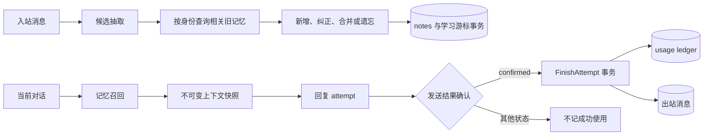

# 记忆与学习改造实施方案

## 结论

本方案将记忆使用统计改为由已确认回复驱动的幂等账本，将学习拆为候选抽取和相关旧笔记协调，并明确热记忆、冷记忆和遗忘证据的读取边界。实施按数据正确性、学习完整性、生命周期与排序、配置和评测四个阶段推进；每阶段都能独立验收。

本文面向负责 `internal/memory`、`internal/chat`、`internal/store`、`internal/config` 和 `schema` 的开发与测试人员，目标是据此实现并验收改造。本文不规定模型供应商、群聊策略、表情包流程或部署环境变更。

> 实施状态：使用账本、分阶段学习、active 热查询、服务端 topic 绑定、配置和离线评测已落地；文中仍保留最初的提案结构和验收思路，当前行为以 [架构说明](ARCHITECTURE.md) 和源码为准。真实模型质量和线上 QQ 行为未由本文验证。

## 现状与目标

### 已核实的现状

| 领域 | 当前行为 | 依据 |
| --- | --- | --- |
| 使用统计 | 记忆召回成功后，`runtimeContextBuilder` 立即调用 `RecordUsage`；该调用位于回复生成和发送前。统计在进程内按 note ID 聚合，后台定时刷到 `use_count`、`last_used_at`。 | [`internal/chat/boundaries.go`](../internal/chat/boundaries.go:163)、[`internal/memory/memory.go`](../internal/memory/memory.go:129)、[`internal/store/store.go`](../internal/store/store.go:310)、[`internal/app/app.go`](../internal/app/app.go:133) |
| 上下文缓存 | 完整上下文缓存命中时，`retrieveResources` 不执行，因此不会调用上述 `RecordUsage`。 | [`internal/chat/boundaries.go`](../internal/chat/boundaries.go:93) |
| 回复确认 | 成功发送后，`applyAndDeliver` 将 attempt 标为 `confirmed`，再由 `FinishAttempt` 事务写 attempt 和出站消息。 | [`internal/chat/turn.go`](../internal/chat/turn.go:165)、[`internal/store/store.go`](../internal/store/store.go:183) |
| 学习窗口 | 每次取 40 条消息，查询最多 1000 条笔记，按 preference 优先、更新时间倒序返回，再由一次模型调用产出 changes。 | [`internal/memory/memory.go`](../internal/memory/memory.go:566)、[`internal/memory/memory.go`](../internal/memory/memory.go:579)、[`internal/store/store.go`](../internal/store/store.go:233) |
| 写入校验 | `Apply` 最多读取 5000 条笔记，用于版本、证据及 forgotten 检查；数据库保存时也检查 forgotten 证据。 | [`internal/memory/memory.go`](../internal/memory/memory.go:442)、[`internal/store/store.go`](../internal/store/store.go:249) |
| 生命周期 | notes 当前只允许 `active`、`forgotten` 两种状态。普通学习查询不筛状态；记忆召回在内存侧筛状态和有效时间，向量查询在 SQL 侧筛选。 | [`schema/schema.sql`](../schema/schema.sql:16)、[`internal/memory/memory.go`](../internal/memory/memory.go:284)、[`internal/store/store.go`](../internal/store/store.go:242) |
| 高级字段 | `Apply` 写入固定 `salience=50`、`confidence=1`。`Change` 有 `expires`，没有 `valid_from`、`valid_to`、`confidence`。 | [`internal/memory/memory.go`](../internal/memory/memory.go:59)、[`internal/memory/memory.go`](../internal/memory/memory.go:537) |
| 召回参数 | `TopK`、`IndexLimit` 可由配置设置；向量距离阈值 `0.6` 及各类 note 预算在代码中固定。 | [`internal/config/config.go`](../internal/config/config.go:35)、[`internal/store/store.go`](../internal/store/store.go:242)、[`internal/memory/memory.go`](../internal/memory/memory.go:68) |
| Episodes | `ContextSnapshot` 有 `Episodes` 字段，但运行构建结果把所有召回笔记写入 `Notes`，不填该字段。episode 在召回中仍有独立预算。 | [`internal/context/builder.go`](../internal/context/builder.go:46)、[`internal/chat/boundaries.go`](../internal/chat/boundaries.go:133)、[`internal/memory/memory.go`](../internal/memory/memory.go:62) |

死数据对当前召回窗口的影响需要准确界定：内存索引读取上限确实会受 notes 总量影响，但召回选择前会过滤 inactive 和无效时间；向量 SQL 也过滤 inactive、过期和时间未生效笔记。因此，本方案首先处理学习输入和索引读取边界，不把“死记录已占满召回结果”当作已证实事实。

当前配置默认每 20 秒运行一次记忆 tick，每 tick 学习一个批次，消息批次上限为 40，单次补建 embedding 上限为 4。调度和默认值见 [`internal/config/config.go`](../internal/config/config.go:126) 与 [`internal/memory/memory.go`](../internal/memory/memory.go:566)。实际处理速率取决于模型和数据库耗时，不能仅由这些默认值推导生产积压量。

### 目标和非目标

目标如下：

- `use_count` 表示被成功确认的回复使用过的笔记次数，且以回复 attempt 为幂等单位。
- 召回缓存命中和未命中执行相同的使用统计逻辑。
- 学习模型只看本批消息和候选相关的旧笔记，不依赖固定的全群笔记窗口。
- forgotten 证据持续阻止旧证据重建，但不挤占普通学习输入和热召回候选。
- `salience`、`confidence`、有效时间和 lifecycle 状态具有明确写入方、校验规则和读取策略。
- 对关键流程建立可回放的正确性评测及运行积压观测。

非目标如下：

- 不把 usage 次数直接解释为模型因果依赖或用户认可。
- 不自动物理删除 forgotten 记录或其证据。
- 不在本方案中更换 embedding 模型、向量库或消息队列。
- 不将未经评测的 usage 权重立即接入生产召回排序。

## 总体流程

改造后的主数据流如下。图中流程表达一致性边界，不表示所有读取均为同步网络调用。



`Snapshot` 保存本次被选中的 note ID。只有 `FinishAttempt` 成功提交 confirmed attempt 时，数据库才写 usage ledger。学习抽取和协调分离后，notes 与学习游标仍在一个事务中提交，避免重复消费或丢失消息窗口。

## 数据模型和接口提案

### Usage ledger

在 `groupfriend` schema 新增使用事件表。建议字段如下：

```sql
CREATE TABLE IF NOT EXISTS groupfriend.note_usage (
  attempt_id TEXT NOT NULL,
  note_id TEXT NOT NULL,
  group_id BIGINT NOT NULL,
  confirmed_at TIMESTAMPTZ NOT NULL,
  PRIMARY KEY (attempt_id, note_id)
);
CREATE INDEX IF NOT EXISTS friend_note_usage_note_time
  ON groupfriend.note_usage(note_id, confirmed_at DESC);
```

`note_id` 不加 notes 外键，避免未来归档分区或保留策略限制账本保存。应用写入时必须验证 note 属于同一 `group_id` 且仍存在；对已遗忘或删除边界的使用记录，仍按确认时快照记账。该选择保持历史统计完整，但要求归档仍保留 note 身份映射。

`FinishAttempt` 接收该 attempt 的已召回 note ID 列表，并在当前事务中执行：

1. 将 `reply_attempts` 从 `sending` 更新为 `confirmed`，要求影响行数为 1。
2. 插入出站消息。
3. 对去重后的 note ID 批量插入 `note_usage`，冲突时忽略。
4. 对本次新插入的 usage 行更新 notes 汇总列 `use_count`、`last_used_at`。
5. 提交事务。

第 4 步只能统计实际插入的 ledger 行。重复调用 `FinishAttempt` 或恢复任务不得重复累加。事务失败时三类数据全部回滚，发送结果按现有逻辑记录为 unknown，不能伪装为未发送。

`notes.use_count` 和 `last_used_at` 保留为可快速读取的汇总投影；ledger 是统计事实来源。增加离线校验查询，对比投影和 ledger 聚合。修复任务按 ledger 重算投影，不能从旧的进程内累计值补造 ledger。

召回 note ID 从 `ContextSnapshot` 传递到 `Attempt` 的持久化 body，或作为 `FinishAttempt` 的显式参数。建议使用显式参数，避免把仅供内部账务的数据混入模型可见内容。上下文 cache value 仍保存 notes，因此 cache hit 也能获得同一组 ID。

### 学习候选与协调

学习拆为两个模型阶段，阶段间传输受校验的候选结构：

```go
type Candidate struct {
    Subject    int64
    Kind       string
    Key        string
    TopicID    string
    Text       string
    Evidence   []Evidence
    Expires    *time.Time
    ValidFrom  *time.Time
    ValidTo    *time.Time
    Confidence *float32
    Forget     bool
}
```

第一阶段只读取本批真实入站消息，返回候选及其证据，不读取全群 notes，也不直接决定已有笔记的 ID 或版本。候选必须通过当前已有的引用校验，包括 event ID 属于本批、quote 原文匹配、成员事实由本人消息支持、候选数量和字段长度受限。

第二阶段按候选的 `(group_id, subject, kind, key)` 查询现存记录；episode 的身份额外包含 `topic_id`。查询结果包含 active、dormant、archived、forgotten 状态、版本、source sequence、有效时间及证据引用。协调器再决定创建、更新原 ID、合并证据、标为 forgotten，或拒绝变更。

协调结果转为当前 `Change` 或新的内部 command，交由 store 在事务中再次检查版本、身份唯一性和 forgotten 证据。模型输出不能绕过事务校验。建议后续增加身份唯一约束，先检查历史重复并制定合并规则，再创建唯一索引，避免迁移遇到既有重复而失败。

抽取和协调分别调用模型会增加延迟、token 和失败点。实现时应把第一阶段候选持久化为可重试的学习工作记录，或在消息游标未提交时允许整批重做；本方案推荐整批重做，并要求两个阶段使用同一稳定的 `(group_id, until_seq)` 工作键。notes 与游标只有在最终保存成功后一起提交。

### 生命周期

当前数据库只接受 `active`、`forgotten`。建议扩充状态：

| 状态 | 热召回 | 普通学习上下文 | 精确协调查询 | 证据保留 |
| --- | --- | --- | --- | --- |
| `active` | 有效时间满足时可召回 | 提供给相关候选 | 是 | 是 |
| `dormant` | 默认不召回 | 默认不提供 | 是，可被新证据唤醒 | 是 |
| `archived` | 不召回 | 不提供 | 身份/审计查询可见 | 是 |
| `forgotten` | 不召回 | 不提供 | 防重建检查必须可见 | 永久保留 |

`expired` 不作为独立状态。记录在 `expires_at <= now()` 后视为不活跃，避免定时任务仅为状态同步而更新大量行。`valid_from`、`valid_to` 控制事实时间区间；它们不替代 `expires_at` 的存储保留含义。

状态转换提案：

```text
active -> dormant -> archived
active -> forgotten
dormant -> active       有新的有效证据且通过协调
archived -> active      明确追溯请求且通过协调
forgotten -> active     仅有更晚的显式新证据，且不复用被遗忘的旧证据
```

`forgotten` 的转换规则必须由现有证据验证逻辑实现，不能由模型自行覆盖。进入 dormant/archived 的阈值和扫描周期尚无生产数据支持，首期先通过查询排除和管理命令验证，不自动批量转状态。物理归档存储属于后续容量优化，不在首期迁移中搬数据。

### 高级字段的所有权

| 字段 | 提议写入方 | 校验与默认规则 | 排序用途 |
| --- | --- | --- | --- |
| `salience` | 服务端策略 | 默认 50；显式“记住/重要”类证据可提升，范围限制为 0 至 100；模型不能直接指定 | 评测通过后作为有限加权项 |
| `confidence` | 抽取模型给候选值，服务端保存 | 缺省 0.7；拒绝 NaN、无穷值及范围外数据；成员事实和偏好仍须满足证据约束 | 先用于质量过滤或并列排序，不单独决定召回 |
| `valid_from` | 抽取模型给候选值 | 接受明确日期；缺省为空；若晚于 `valid_to` 则拒绝该变更 | 仅参与有效时间过滤 |
| `valid_to` | 抽取模型给候选值 | 接受明确终止日期；缺省为空；采用左闭右开区间 `[valid_from, valid_to)` | 仅参与有效时间过滤 |
| `expires_at` | 抽取模型给候选值 | 仅用于明确临时事实的存储过期；不能代替事实有效时间 | 过期后不进入热路径 |
| `use_count`、`last_used_at` | 数据库事务投影 | 只能从幂等 usage ledger 更新 | 不允许模型写入 |

`confidence=0.7` 是初始设计默认值，不是当前数据测量结果。正式启用前需用人工标注样本检查候选置信度校准；如果模型不稳定输出置信度，服务端应忽略模型值并使用策略默认值。

## 分阶段实施任务

### 阶段一：确认回复使用账本

1. 在 `schema/schema.sql` 增加 `note_usage` 和索引，更新 `schema/README.md` 的表说明。
2. 为 `FinishAttempt` 增加 note ID 参数，并保持 confirmed 状态更新、出站消息和 usage ledger 在一个事务内提交。
3. 从上下文快照保留唯一 note ID 列表；确保完整上下文 cache hit 与 miss 都传递同样的列表。
4. 移除 `runtimeContextBuilder.retrieveResources` 中的 `RecordUsage` 调用。
5. 删除进程内 usage map、`RecordUsage`、`FlushUsage`、`FlushNoteUsage`、`UsageFlushInterval` 及应用后台 flush 任务。
6. 将回放 store 实现更新为与 SQL store 一致的幂等语义。
7. 增加 SQL 集成测试，覆盖事务回滚、重复 attempt、重复 note ID、跨群 note ID、attempt 非 sending、cache hit 和 cache miss。
8. 增加回放测试，验证 confirmed 计数一次，silent/failed/limited/stale/preview/unknown 计数为零。

迁移期保留旧汇总字段，不将历史 `use_count` 转换为 ledger 行。新 ledger 从部署时开始提供可信统计；旧汇总值在上线策略中选择清零或作为 `legacy_use_count` 保留。推荐新增 `usage_version` 或单独历史基线，避免把旧的不可靠次数冒充为新语义。

### 阶段二：候选抽取与旧记忆协调

1. 定义候选 DTO、JSON schema、数量和长度上限，增加提示版本 `memory-extract-v2`。
2. 抽取阶段只发送当前学习批次，不发送全群 notes。
3. 新增按身份批量查询接口，返回候选身份对应的所有状态笔记及版本。
4. 定义协调阶段输入和输出，采用新的提示版本 `memory-reconcile-v1`。
5. 将协调结果映射到服务端 command；ID、version 和 state 由服务端依据查询结果绑定，不接受模型伪造。
6. 修改保存事务，按候选身份锁定相关记录并校验 revision、证据及 forgotten 规则。
7. notes 写入成功后，在同一事务推进学习游标；无变更批次也要推进游标。
8. 对模型错误、JSON 错误、校验错误和数据库冲突分别设置重试退避，并保证同一批次重试幂等。
9. 增加纠错、重复候选、同批冲突、历史 forgotten、跨群隔离和并发更新测试。

过渡期不能同时启用新旧学习器处理同一 group cursor。使用配置开关按群或全局选择唯一学习器；默认保持旧流程，观测新流程回放结果后再切换。notes 写入端始终只有一个生效学习器。

### 阶段三：热查询、生命周期和字段

1. 将 `Notes` 拆分为明确用途的接口，例如 `LearningCandidates`、`NotesByIdentity`、`ForgottenEvidence` 和管理审计查询，避免一个通用窗口承担不同语义。
2. 普通学习候选查询只返回 active 且未过期记录；精确协调仍能读取 dormant、archived、forgotten。
3. 热索引构建只载入 active 且当前可用的记录；对过期条件采用数据库时间过滤，避免无效记录占用 index limit。
4. 修改唯一身份冲突前，运行只读重复身份盘点；制定保留 ID、合并 evidence、revision 和 embedding 重建规则。
5. 在重复清理或显式冲突处理完成后，增加 `(group_id, subject, kind, key, topic_id)` 身份唯一约束或部分唯一索引。确认 key 大小写与规范化规则后再决定表达式索引。
6. 扩充状态约束以支持 dormant、archived；先发布兼容代码，再执行约束迁移。
7. 扩展候选结构以承载有效时间和置信度；由服务端执行范围、日期关系和默认值校验。
8. 给 salience 实现服务端推导规则，并记录推导原因供后台审计；首期不把 usage 直接混入排序。
9. 明确 `Episodes` 的公共接口用途。若不存在独立消费者，则删除字段和相关转换；若管理 API 需要独立 episode 视图，则单独实现并补充预算测试后保留。

迁移使用 `CREATE/ALTER ... IF NOT EXISTS` 的幂等模式，与当前 schema 初始化方式一致。破坏性约束变更前先检查现有行；任何自动转换都必须可重跑并写清冲突处理规则。

### 阶段四：配置、评测与观测

1. 增加 `memory.semantic_distance_threshold`、`memory.preference_budget`、`memory.member_budget`、`memory.episode_budget` 配置及默认值和范围校验。
2. 保持 `TopK`、`IndexLimit` 现有配置，不重复引入别名。
3. 将阈值从 store SQL 硬编码改为参数；验证索引查询计划仍能使用向量索引。若参数化影响 pgvector 索引选择，采用受控配置映射或固定查询形态并用 `EXPLAIN` 验证。
4. 构建脱敏记忆评测集，覆盖正确召回、无关召回、旧事实纠错、遗忘保护、过期和未来有效时间、episode 话题匹配、成员证据归属。
5. 记录学习 lag：每群最新入站 seq 减 `after_seq`；同时记录每 tick 批次数、成功/失败、耗时、抽取与协调 token、pending embedding 数。
6. 记录召回候选数、最终命中数、空召回、语义降级、召回 cache hit/miss 和耗时。
7. 从 usage ledger 计算确认使用率和投影差异；记录 ledger 写入失败及重试数。
8. 以离线回放比较变更前后 precision@k、recall@k、forgotten 违规数、重复笔记率和纠错一致性。没有标注依据的指标不宣称质量提升。

## 配置提案

新增配置示例：

```yaml
memory:
  usage_ledger_enabled: false
  semantic_distance_threshold: 0.6
  preference_budget: 6
  member_budget: 8
  episode_budget: 6
  learning_mode: legacy # legacy 或 staged
```

`usage_ledger_enabled` 默认关闭；启用后，confirmed attempt 在 `FinishAttempt` 事务内写入 ledger。它只控制新账本写入，不应恢复进程内聚合计数。默认值沿用当前阈值和召回预算，保证配置缺失时行为可预测。阈值必须在 `(0, 2]` 范围内，预算必须大于等于 0 且总量受配置校验上限约束。确切上限以 `TopK`、上下文 token 预算和评测结果确定，不在此伪造容量结论。`usage_ledger_enabled` 与 `learning_mode` 仅在迁移期存在，稳定切换后删除。

模型阶段的超时、最大输出 token、重试次数和每群并发需要复用现有 background model budget。初次实现前核对 `model.Gateway` 当前对 background request 的超时与输出限制，不在配置上重复暴露已经由模型配置控制的字段。

## 失败处理与一致性要求

| 失败点 | 必须保持的状态 | 重试方式 |
| --- | --- | --- |
| 回复发送明确失败 | attempt 为 failed，不插入 usage | 不重试该发送 attempt |
| 回复发送结果未知 | attempt 为 unknown，不插入 usage | 依据现有发送恢复策略处理；不得仅凭调用方重放累加 |
| usage ledger 写入失败 | confirmed、出站消息和 ledger 同事务回滚；随后 attempt 结果可能记为 unknown | 以 attempt ID 安全恢复；不创建新 attempt 伪造成功 |
| 学习抽取失败 | notes 和游标不变 | 同一 `(group_id, until_seq)` 延迟重试 |
| 学习协调失败 | notes 和游标不变 | 同一批次重新协调；抽取结果可重算 |
| notes 保存成功但游标失败 | 必须由同一事务避免 | 回滚整个事务 |
| 旧记忆 revision 冲突 | 不覆盖新版本 | 重新查询并执行协调 |
| 过期或无效时间区间 | 拒绝候选或将其隔离，不进入热召回 | 记录结构化原因，不默默修正日期 |

在发送成功而数据库事务暂时失败时，不能做到外部 QQ 发送与本地 SQL 的原子提交。现有系统将归档失败标为 unknown。usage ledger 只能在本地 confirmed 事务成功时提交，因此可能暂时漏记一次真实送达，但不会把未确认发送算作成功。上线前需决定是否增加基于平台 message ID 的 reconciliation；该能力取决于 OneBot 侧是否可可靠查询发送结果。

## 上线与回滚

1. 发布兼容 schema，先新增 ledger 和必要索引，不改变现有读取行为。
2. 部署应用代码，使用 feature flag 关闭 ledger 统计，验证 schema 初始化、健康检查和常规聊天。
3. 启用 ledger 写入，检查确认回复与 ledger 行数一致，并重复回放同一 attempt 验证幂等。
4. 运行学习器离线回放，不写生产 notes，检查候选证据、身份匹配和 forgotten 约束。
5. 选择小范围开启 staged 学习，观测游标 lag、错误率、重复率和模型消耗。
6. 达到验收阈值后扩大范围；切换期间一个群只能有一个学习器写入。
7. 按阶段二迁移完成后移除 legacy 学习器和过渡开关。

回滚应用时保留新表和新增列。旧版本不得读取 usage ledger，因此可回退应用代码；如旧代码仍执行 `FlushUsage`，应在切回前确认相关方法和旧字段仍兼容。不可在回滚时删除 ledger 或状态值，否则会丢失确认事件或令新数据违反 schema。新增 dormant/archived 状态后，回滚到不认识该状态的代码前，必须暂停写入新状态或先运行可审计的状态回退迁移。

## 验收标准

### 正确性

- 同一 `(attempt_id, note_id)` 最多有一条 ledger 记录，重复提交不会增加汇总次数。
- confirmed attempt 的每个唯一召回 note ID 恰好写入一条 ledger；非 confirmed 状态没有 usage 行。
- cache hit 和 miss 的统计结果一致。
- ledger 插入、attempt confirmed 和出站消息写入同事务提交或回滚。
- 学习模型不会收到全群固定 1000 条笔记作为通用历史上下文。
- 对每个候选，协调阶段能够看到身份匹配的所有相关状态笔记，包括 forgotten。
- 旧证据不能重新激活 forgotten 笔记；更晚的显式证据也不能复用被遗忘的旧 event ID。
- 学习 notes 更新和游标推进原子提交；失败重试不会重复创建身份记录。
- inactive、expired、未来生效和 valid_to 已到期笔记不进入热召回及向量候选。
- salience、confidence、valid_from、valid_to 均有服务端校验和边界测试。

### 质量与运行

- 评测集覆盖本方案列出的事实、纠错、遗忘、时间、episode 和成员归属场景，并记录基线。
- 每群学习 lag、每阶段耗时与 token、pending embedding、空召回、语义降级和 ledger 失败可查询。
- 配置缺失时使用明确默认值；无效阈值或预算在启动校验阶段失败。
- 对典型数据量运行 `EXPLAIN (ANALYZE, BUFFERS)`，确认向量距离阈值查询未意外退化为全表扫描。测试环境结果不等同于生产容量结论。
- `rtk go test ./...`、`rtk go test -race ./...`、数据库集成测试和确定性回放通过。若测试依赖外部数据库或模型，报告必须区分已执行和未执行项。

## 风险与待确认事项

| 事项 | 风险 | 负责人需要确认的决策 |
| --- | --- | --- |
| 旧 use_count 迁移 | 旧统计混合了召回尝试与 cache miss，无法还原为 confirmed ledger | 保留为历史基线，还是清零重算投影 |
| Note 身份唯一性 | 历史 key 可能大小写、空格或命名不一致，唯一索引可能失败 | key 规范化规则及重复记录的主记录选择策略 |
| 两阶段模型成本 | 每批最多两次模型调用，增加成本和失败概率 | 每阶段 token 上限、是否允许只在有候选时调用协调模型 |
| 生命周期转换 | 当前没有 dormant/archive 的成熟度量阈值 | 首期只做查询隔离，或同时启用自动状态转换 |
| 置信度校准 | 模型给出的概率值不一定与正确率匹配 | 是否首期只记录值而不参与排序，推荐先记录和评测 |
| 发送确认恢复 | QQ 外部发送与本地 SQL 无法构成分布式事务 | 是否接入平台查询接口修复 unknown attempt 的 usage 漏记 |
| 评测数据 | 没有现成的人工标注评测集 | 由记忆功能负责人和测试负责人共同提供脱敏样本及预期答案 |

推荐决策是先保留旧 `use_count` 作为不可参与新排序的历史值，新账本从启用时间起累计；生命周期首期只落实查询过滤，不自动批量归档；置信度首期只采集和评测。以上推荐不替代负责人对数据保留策略的确认。

## 相关文档

- 当前系统总体架构见 [`ARCHITECTURE.md`](ARCHITECTURE.md)。
- 现有跨模块缺口清单见 [`ARCHITECTURE_REFACTOR_GAP_REMEDIATION.md`](ARCHITECTURE_REFACTOR_GAP_REMEDIATION.md)。本方案只展开记忆与学习专项设计，实施时以源码和本方案的决策为准。
- 数据库当前基线见 [`schema/README.md`](../schema/README.md)。
