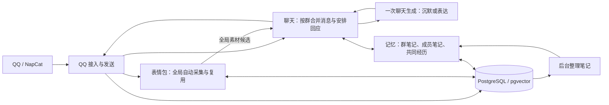

# QQ AI 群友重设计方案

状态：设计提案，尚未实施。面向项目维护者评审重写方向，正文说明行为与取舍，附录说明模块、数据和验收边界。当前运行架构仍见 [ARCHITECTURE.md](./ARCHITECTURE.md)。

## 1. 推荐方向

建议把 go-agent 收敛为长期参与 QQ 群聊的虚拟群友，核心只保留聊天和记忆。文字、图片和表情包服务于相处；运维后台提供排错、记忆与素材纠错。完整移除 Codex 控制、MCP、文件任务及其权限、确认、工作区和产物链路。

真人感的优先级是：分清谁在跟谁说话，选择合适的接话时机，接住上下文，记住共同经历，保持口吻和态度的连续性。架构围绕这些行为组织，删除不能证明有帮助的模拟状态与通用框架。

一个 Go 进程连接 NapCat、PostgreSQL 和聊天模型。模型判断社交语境，程序负责消息顺序、资源限额、资料范围和实际发送。普通聊天不进入工具循环，也不依次经过独立的场景、关系、情绪和人物事实服务。

自动积累表情包、向量索引和多路融合检索属于保留的群友能力。表情包模块负责积累表达素材，记忆模块负责长期回忆，两者复用检索算法与存储。

## 2. 当前实现依据

以下结论来自提交 `500b421a593eca78b768772879c8548013601fca` 的静态源码核对。分析时工作区无未提交修改；没有据此验证真实 QQ、线上模型或群友反馈。这里列的是设计依据，不能直接当作线上问题的诊断结果。

| 已核对事实 | 源码依据 | 对重设计的启发 |
| --- | --- | --- |
| 普通事件默认使用 `answer`，该目标文案把事件描述为对机器人说的话；同时静态提示词又要求未指向机器人时默认沉默 | [deliberator.go](../internal/application/presence/deliberation/deliberator.go) 的 `decisionFor`；[dialogue_act.go](../internal/application/prompting/dialogue_act.go) 的 `dialogueGoal`；[composer.go](../internal/application/prompting/composer.go) 的 `StaticInstruction` | 收件人和参与意愿由同一次模型判断，程序不预置回复目标 |
| 同群开始新回合时会取消旧回合 | [lifecycle.go](../internal/application/presence/lifecycle.go) 的 `beginTurn` | 普通群消息应能继续进入上下文，避免热闹群反复打断生成 |
| 冷却检查只检查群状态，不区分直接追问和自主插话 | [turn_observer.go](../internal/application/presence/reflection/turn_observer.go) 的 `CanDeliberate` | 限制插话频率，同时保留连续对话能力 |
| 收到消息和机器人回复会推进关系数值；人物状态由规则转换和定时衰减维护 | [models.go](../internal/domain/relationship/models.go) 的 `Apply`；[persona/service.go](../internal/application/persona/service.go) 的 `transitionState`、`RegisterJobs` | 消息次数不能直接说明亲密程度，用实际相处证据代替加分机制 |
| 上下文需要读取人物状态和人物事实，相关读取失败会终止本轮；普通记忆、关系和场景读取可降级 | [context/service.go](../internal/application/context/service.go) 的 `BuildSnapshot` | 减少普通聊天的前置依赖，静态人物设定随进程加载 |
| 主模型通过 Eino Agent 和工具循环生成计划；Codex、确认与工作区接入运行主链路 | [agent_planner.go](../internal/application/prompting/agent_planner.go) 的 `Plan`；[runtime_builder.go](../internal/app/runtime_builder.go) 的 `buildRuntimeGraph` | 删除工具任务后直接生成表达结果，重写主链路 |
| 已有图片与贴纸自动采集，以及记忆、表情包的词法和向量召回、RRF 融合 | [meme/service.go](../internal/application/meme/service.go) 的 `ObserveEvent`；[retrieval/service.go](../internal/application/retrieval/service.go) 的 `SearchMemories`、`SearchMemes` | 保留有效能力，按新职责重写，素材全局共享、记忆按群隔离；不以简化为由整体删除 |

## 3. 功能取舍

| 能力 | 新方案 | 作用或删除原因 |
| --- | --- | --- |
| 普通群聊、@、引用、连续追问 | 保留并重写 | 群友的基本参与方式 |
| 沉默与少量自主插话 | 保留 | 允许旁听，也能在合适的时候接话 |
| 稳定口吻、少量兴趣和人物背景 | 保留并缩短配置 | 让表达有辨识度，减少每轮重复灌入设定 |
| 群友称呼、明确偏好、共同经历、群内梗 | 合并为有来源的笔记 | 提供长期相处的连续性 |
| 图片理解、文字 emoji、表情包自动采集与复用 | 保留 | 从各群自动积累全局表达素材，按语境选择；维护者只需纠错或补充 |
| 好感、信任、摩擦、社交温度、情绪、精力及其衰减 | 删除 | 不再用固定公式模拟关系和心情 |
| 成员活跃分、口头禅统计、反馈窗口和独立关系事件流 | 删除 | 相处方式由笔记与实际对话提供，无需多份派生状态 |
| 自动扩写人物经历、人物事实槽位、预留与提交协议 | 删除 | 人物设定由维护者管理，模型不自动创造人生履历 |
| Codex 控制、本地命令、文件处理与文件交付 | 完整删除 | 超出群友方向，连带删除写权限和 QQ 确认流程 |
| MCP、工具发现、工具白名单、通用 Agent 运行时 | 删除 | 首版不提供外部任务平台；实时信息未知时如实表达 |
| 戳回、自动撤回纠正、复合动作计划 | 删除 | 首版表达收敛为文字、可选引用和表情包；口误直接自然纠正 |
| 向量索引、词法召回与多路融合检索 | 保留并收拢职责 | 记忆与表情包保留各自检索入口，复用融合算法和 PostgreSQL/pgvector |
| 独立反思调用、历史判断回灌、通用 Outbox 和任务调度框架 | 删除 | 笔记整理、采集与索引使用各自可恢复的进度，不恢复通用任务平台 |
| 关系图、任务队列、MCP 配置、完整监控大盘 | 删除 | 运维保留对话回放、简短运行与检索记录、笔记和素材纠错 |
| 视频、语音理解与生成式媒体 | 首版不做 | 先验证文字和图片交流质量，遇到不支持的附件不假装看懂 |

这些是目标方案的删除范围，当前代码尚未删除。普通知识交流仍可直接使用模型，群友不承诺执行代码、查询实时数据或交付文件。

## 4. 群里应该出现的行为

### 4.1 接话有分寸

| 群聊情境 | 期望行为 |
| --- | --- |
| A 问 B「今晚来不来」，未涉及机器人 | 通常旁听，不把问句当作自己的任务 |
| 明确 @、点名、引用机器人，或接着机器人的话继续说 | 优先处理，结合上一段对话回应，不被自主插话的冷却挡住 |
| 熟悉的话题出现一个自然空当 | 可以补一句自己的看法或接梗，也可以不说；兴趣关键词本身不构成必回条件 |
| 同一个人连续发「我刚才」「把数据库」「删了」 | 合并理解后回应，不抢答第一小句 |
| 多个人同时聊不同事情 | 保留作者和引用关系，回答相关对话；必要时引用具体消息 |
| 群友认真倾诉、纠正误解或表示不喜欢玩笑 | 收起调侃，承认具体问题，调整后续相处方式 |
| 机器人说完后没人接 | 自然结束，不追问「怎么不说话」，不自动补充第二段 |

被 @ 时也允许沉默，但不通过随机概率、低好感或虚构的坏心情决定是否理人。优先依据消息是否需要回应、是否已经结束，以及是否存在实际表达内容。

### 4.2 表达有自己的习惯

人物配置只写稳定口吻、少量兴趣、基本背景与少量对话样例。样例覆盖认真回答、随口接话和沉默；它们示范节奏，不提供每轮照抄的台词。优先复用现有角色中仍合适的素材，不额外编造姓名、学校或现实身份。

闲聊可以只有几个字，也可以在别人认真问问题时完整解释。程序不统一截成两句，不机械切气泡，不强制每次追问或给建议。普通表达默认一条消息，文字可以带自然换行；表情包也可以独立表达。

关系差异由具体事实体现，例如「以前一起聊过这个」「对方明确说过不喜欢这个称呼」。陌生成员按普通群友相处，熟悉后可以自然简略或调侃。没有证据时不假装熟悉，也不根据聊天次数自动升级关系。

角色可以有稳定立场、偏好和当下反应，不追求每次都热情周全。不会靠故意打错字、随机拒绝、固定延迟、假装睡觉或编造线下日程制造真人感。直接被问到自身性质时如实说明是虚拟群友；日常聊天维持角色口吻。

## 5. 聊天主链路

### 5.1 从一小段对话开始

每条获准处理的事件先按平台事件标识去重并归档，再进入所属群的消息缓冲。相同文字可能是复读或多人接梗，不能只凭内容相同丢弃。正文、说话人、时间和引用对象保持独立，合并处理不等于把多人消息拼成一个人的发言。

每群只运行一个聊天协调器：合并短时间内的分条消息，保留尚未处理的消息，安排模型请求。合并窗口同时设最长等待，持续刷屏也不能让直接提问永远等不到处理。不引入跨群队列服务或话题图谱。

协调器把明确 @、点名、引用机器人的消息优先送入模型。机器人刚参与过的对话保留短暂活跃窗口，相关参与者的新消息也优先进入判断，以接住没有再次 @ 的追问。优先判断不等于认定收件人，最终是否在跟机器人交流仍由模型结合上下文判断。普通旁听按较低频率合并评估，模型仍能发现自然插话点。

程序保留全局模型并发上限和每群发言总额。自主插话另设更严格的间隔；直接追问可以绕过插话间隔，但仍受总额限制。笔记整理、素材理解和索引更新在聊天请求之后使用模型资源，不抢占正在对话的请求。

### 5.2 一次判断同时决定是否表达

聊天生成模型的输入只有稳定人物设定、近期真实对话、当前批次、检索出的相关笔记、必要的图片、少量表情包候选和简短的输出约定。收件人、称呼、引用关系和当前时间都明确标识；资料与群消息作为数据输入。检索所需的 Embedding 请求属于资料准备，不增加参与判断或表达生成轮次。

模型一次返回沉默、文字或表情包之一。文字可以附带引用对象，表情包只能选择本轮提供的素材编号。表达结果只含动作、内容、目标和简短理由码；明确的记忆请求另附第 7.3 节规定的笔记修改，不要求输出推理过程、社交分数或复杂回复计划。

> **决策：单次请求完成参与与表达**
>
> **做法：** 同一次聊天生成请求选择沉默或给出最终表达，发送由程序完成；Embedding 与后台素材理解分别受资源预算约束。
>
> **理由：** 参与判断和内容生成看到同一份语境，避免程序先要求回答、模型再尝试保持沉默。单次请求不能保证模型总能识别微妙的社交关系。
>
> **备选：** 独立小模型先筛选有助于降低大量旁听的成本，但会增加误拦截与两套提示词的维护。首版先用消息合并和评估间隔限制成本。
>
> **退路：** 如果真实回放表明旁听成本不可接受，再以同一套参与标注验证筛选器；不恢复通用工具循环。

### 5.3 新消息不再一律打断旧回复

生成期间的新消息照常归档和进入缓冲。无关的群内发言不取消模型请求；本轮完成后再处理新批次。每次请求绑定自己的输入范围和回应目标，不通过锁住群状态等待模型。

发送前只做可以明确判断的检查：群仍启用、未超过总额、回应对象和素材有效、结果未超时，以及是否出现更新的 @、点名或引用机器人消息。这类明确互动使旧草稿失效，下一轮优先合并处理；同一候选不循环重试。活跃窗口中的普通新消息只增加下一轮的处理优先级，不直接使草稿失效，必要时引用原消息消除歧义。程序不另起模型请求猜测每条新消息是否构成语义纠正，因此可能先发出针对上一句的回答，再在后续交流中修正。

撤回目标消息、停机或关闭群会取消相关工作。已过时的自主插话直接放弃，不在几分钟后补发。任何尚未发送的草稿和沉默决定都不进入下一轮的聊天事实。

### 5.4 图片理解进入正常表达

优先使用能够直接接收图片的聊天模型，将当前对话需要的图片与文字一起送入本轮请求。限制图片数量、下载大小和等待时间；聊天不等待全群图片完成分析。可复用的素材描述交给第 5.5 节的后台采集处理，不为同一份内容反复理解。

图片不可用时不生成虚假的画面描述。明确询问图片内容时可以简短说明没加载出来；普通闲聊可以沉默。慢到达的图片结果不另开一轮补发。

### 5.5 自动积累全局表情包

默认从获准处理的各群入站图片和贴纸中自动识别表情包，收入全局素材池，供所有获准群使用，不要求群友说「收藏」，也不要求维护者逐张确认。明显用于表达态度或接梗的素材可以收入；普通照片、业务截图和语义不明的图片不直接当作表情包。判断不清的素材先不进入可发送候选。

原事件归档后，程序按下载限额及时缓存候选，避免完全依赖会失效的临时图片链接。后台根据内容哈希去重，复用已有图片理解结果，必要时补充简短的画面、文字、表达含义和适用语境；GIF 保留可发送原文件，理解时使用有界的帧采样。采集不阻塞当前聊天，也不因入库成功单独向群里发消息。

素材描述与适用语境保留词法和向量索引。回应前在全局可用素材中多路召回，融合后只提供少量候选给聊天模型。模型选择素材编号，程序验证素材状态、文件存在及重复发送间隔，再执行发送；不向模型开放任意文件路径。

全局保存素材的表达含义；源群的人名、群号及私人对话不进入跨群可见的描述。群内特定梗的背景仍放在该群记忆中，不能仅凭画面相似认定表达相同含义。全局限制素材数量和磁盘用量，先淘汰长期未出现、少使用的素材；确认送达后才更新该群的发送时间，重复发送冷却按群计算。保留删除、禁用和纠错入口，禁用标记防止相同内容被自动重新收回。

下载、识别或索引失败只影响该素材。候选与处理状态持久化在素材记录中，重启后可继续处理未完成记录；超过临时缓存时限或容量的候选可以放弃。向量暂不可用时，已理解素材仍可走词法召回；没有合适素材就说话或沉默，不为用图而硬发。

## 6. 人格与关系的简化

> **决策：稳定设定加相处证据**
>
> **做法：** 人物设定由维护者管理，关系与语气参考最近对话和有来源的相处笔记。
>
> **理由：** 可以直接解释一次称呼或态度变化的依据，移除数值状态的更新、衰减和反馈归因。模型仍可能误读语气，需要对话回放验证。
>
> **备选：** 数值化关系便于运营调参和画图，但聊天次数、回复次数与亲密程度没有固定对应关系，首版不把这些数值当作社交依据。
>
> **退路：** 笔记不足时按普通群友相处；人物设定保持稳定，不临时编造亲密关系或人物经历。

机器人自己生成的陈述不能自动升级为人物背景或事实。真实群内互动可以形成共同经历，例如「上次一起讨论了某个游戏」；「我昨天去某地吃饭」这样的生成文本不能成为可回忆的真实经历。

人物设定与群内记忆分开。各群共享同一个角色设定，各群发生的人和事按群保存；同一个 QQ 用户出现在两个群，也不默认把一个群的相处信息带进另一个群。

## 7. 记忆只维护值得继续使用的笔记

### 7.1 近期对话与长期笔记分工

近期对话保留消息原文和引用关系，供模型理解当前正在聊什么。超出上下文预算时才整理摘要，摘要不能覆盖仍然需要逐句理解的最新对话。

长期笔记统一存储，按用途分为群笔记、成员笔记和经历笔记。群笔记记录群内称呼习惯、可解释的梗及相处约定；成员笔记记录本人明确表达的偏好与重要近况；经历笔记记录真实发生、以后可能再聊起的事情。它们共用来源、范围、修订和失效规则，不建立三套服务。

不是每条消息都值得记住。一次性的情绪、顺口玩笑、无关图片和未经核实的他人评价通常不写入长期笔记。涉及别人的陈述保留说话人和转述性质；机器人旁听的群内事件不能被写成它亲自参与的经历。

### 7.2 多路召回找回相关记忆

每轮先精确读取当前群及相关成员的称呼、明确偏好和相处约定，这些内容不依赖相似度排名，也不受检索 TopK 截断。其余笔记与经历从当前整段对话生成检索输入，避免只看最后一句「然后呢」。

保留以下召回轨道，并行取得有界候选：

| 轨道 | 负责找回的内容 |
| --- | --- |
| 语义向量 | 同义说法、隐含关联和关键词变化后的旧话题，使用 Embedding 与 pgvector 向量索引 |
| 词法匹配 | 人名、游戏名、专有名词、原话与群内梗，使用 BM25 等词法排序 |
| 人物与时间线索 | 与当前参与者、明确提到的时间或事件有关的经历，避免只靠文本相似度找人和事 |

各路先执行群、成员可见性、有效期和失效状态过滤，再按笔记标识去重并使用 RRF 融合。人物与时间轨道只召回满足明确线索的相关记录，不能用整批最新笔记挤占语义相关结果。融合后按相关性、证据时间及上下文预算保留结果；排名分数只表示相关程度，不能把未核实的转述升级为事实。

称呼与明确约束优先保留；经历可压缩为带来源的简短片段，必要时回查对应消息。模型看到的是检索出的可核对资料，不是多路候选列表或检索过程。记录各路命中、最终笔记标识、耗时与降级原因，便于解释漏记和错记。

笔记原文是权威数据，向量和词法索引是可重建投影。更新笔记时提高内容版本并标记待索引；后台只为仍然有效的同版本内容提交索引。纠正、过期、遗忘后，旧版本即使仍有向量也不能参与召回；失败可重试，并可按模型版本回填，不让旧索引重新激活失效事实。

向量轨道超时可以使用词法与人物、时间轨道，单路失败不阻断普通聊天；全路失败时仅使用近期对话与已读到的明确约束，并记录降级。Embedding 的等待计入本轮资料准备预算，不能无限等待。

### 7.3 写入、纠正和遗忘可追溯

后台整理器按持久化消息序号读取新增事件，复用聊天模型低优先级更新笔记。它独立于机器人是否发言，旁听期间也可以记住值得保留的群内事件。整理器输出笔记修改及原始消息标识；程序验证群、作者、引用证据、时间和可修改范围。

明确的「记住」「以后这样叫我」「这件事说错了」「忘掉这个」由当前聊天请求附带笔记修改建议，使用同一校验和写入函数，不走通用工具。成员偏好只接受本人陈述或维护者纠正；群友消息不能修改人物设定。机器人只有在写入成功后才能确认已经记住或忘记；写入失败时不发送成功文案。

纠正覆盖相关旧结论，并保留其失效状态；互相矛盾且无法判定的内容暂不作为确定事实使用。遗忘保留最小失效标记，阻止后台从同一份旧证据重新生成已忘记的笔记。新的明确陈述可以建立新的有效记录。

每条笔记保留来源事件、主体、有效范围和修订版本。后台以版本检查提交修改，并在同一事务推进整理游标；失败不推进，重启后从原游标继续。过期的临时近况不再进入上下文，长期称呼与偏好保留到被纠正或遗忘。

> **决策：消息原文加简短笔记**
>
> **做法：** 真实消息是来源，笔记是可修订的长期信息；后台进度由数据库游标恢复。
>
> **理由：** 避免聊天、画像、关系、人物事实分别维护相近信息。笔记配合多路检索支持长期回忆，仍不保证完整记住所有历史。
>
> **备选：** 直接对全量聊天历史分块建索引能扩大覆盖，但容易把玩笑、临时近况和已被纠正的内容重新召回。首版以筛选后的笔记和经历为检索主体，原消息用于查证。
>
> **退路：** 某路索引失败时使用其余召回轨道；普通笔记读取失败时使用近期对话，并按不熟悉的群友相处。明确的保存与删除请求不能虚报成功。

> **决策：保留多路检索，统一维护边界**
>
> **做法：** 向量索引、词法召回和融合由记忆模块维护，表情包模块复用融合算法；记忆过滤群与成员范围，素材全局可用；两者均校验状态和版本。
>
> **理由：** 语义关联与精确词各有用途，长期相处需要两者互补。索引和融合服务于聊天资料准备，不要求主模型调用检索工具。
>
> **备选：** 只做关键词匹配更容易实现，但会漏掉换一种说法的旧经历；只用向量也可能漏掉人名、原话和罕见群内词。因此两路都保留，并补充有明确条件的人物与时间召回。
>
> **代价与退路：** 需要 Embedding 成本、索引修复及检索质量验证。复用同一 PostgreSQL/pgvector，不另建检索服务；单路故障按第 7.2 节降级。

## 8. 重写范围与落地顺序

建议直接重建内部模块与数据库基线，不适配旧接口、旧配置或旧表结构。复用现有 QQ 与模型适配中仍适用的协议实现，按新边界重写调用者，并在切换前重新验证。Eino 若仍被模型客户端依赖，可以保留必要部分；不为删除一个依赖重做全部模型协议，也不保留 ADK、工具节点与 Agent 循环。

运维入口保留近期对话、发送与检索状态、笔记和表情包纠错。模型耗时、用量、失败原因通过简短运行记录查看，不再维护关系曲线、任务平台和独立反思记录。重写聊天原型时先用本地回放与日志，运维页面等主链路验证后再接入。

| 顺序 | 可检查的交付物 | 进入下一步的条件 |
| --- | --- | --- |
| 建立行为基线 | `tests/replay/` 中的群聊片段、参与标注、上下文与人物设定；覆盖第 9 章场景 | 能区分不该插话、应该接话、记忆错误和表达生硬；用现实现回放作为比较基线 |
| 重建文字主链路 | 新聊天协调器、单次聊天生成、实际发送记录和仅回放不发送模式 | 直接互动与旁听能区分；普通新消息不会反复取消回复；发送异常不会重复补发 |
| 接入记忆和图片表达 | 有来源的笔记、多路融合检索、索引修复、图片输入和表情包自动采集 | 换一种说法能找回旧经历；纠正与遗忘不被旧索引绕过；采集不阻塞聊天，故障时没有虚假图片描述 |
| 删除旧系统并切换 | 删除清单对应的源码、配置、依赖、旧页面和文档说明；新的部署与启动入口 | 构建、边界测试、回放比较通过；目标群只有一个实例拥有发送权 |

原型直接按附录 A 的新模块实现，不包在旧 Presence 或 Planner 后面。验证期间只运行一个会向 QQ 发消息的实例；另一个版本仅接受录制输入并记录结果。正式切换采用停旧启新，不为双写、灰度路由或旧表适配增加常驻代码。

新版本使用新数据库基线。旧数据可以备份后停用；必要的角色设定和少量可靠笔记可人工整理进入新库，不要求迁移所有历史。这个方案和本轮文档工作均不依赖删除现有数据库。

## 9. 验收以对话效果为主

以下是计划验证的场景，尚未执行。程序测试验证顺序、隔离与发送边界；模型效果通过完整上下文回放和人工阅读判断。

| 场景 | 要看到的结果 |
| --- | --- |
| A 和 B 连续互聊，机器人未参与 | 不抢答别人的定向问题；偶尔插话须有可指出的新增内容或自然笑点 |
| 群友分条发言，其他人同时发消息 | 结合完整意思回答，作者和引用目标不混淆 |
| 机器人回复后群友继续追问，同时群里很活跃 | 回答能完成，能接着聊，不被普通群消息持续取消，不受插话间隔误拦截 |
| 同一消息重复投递；不同人主动复读同一文字 | 重复投递不引发重复发送，真实复读保留在上下文 |
| 认真倾诉、普通闲聊、熟人玩笑混合出现 | 语气随语境调整，避免连续玩梗、客服腔、固定结尾和机械反问 |
| 昨天讨论过的事今天再次出现，随后有人纠正 | 能使用有来源的经历，纠正后不继续沿用旧结论 |
| 请求遗忘后重启，再运行后台整理 | 已失效笔记不被旧证据重新生成，普通对话仍可继续 |
| 同一人在两个群使用不同称呼或约定 | 使用当前群的记忆，不泄漏另一个群的信息 |
| 使用同义表达回忆旧事，或查询罕见人名、游戏名、群内梗 | 向量、词法与人物时间轨道各自发挥作用，融合去重后结果有来源，明确称呼和偏好不被 TopK 漏掉 |
| 纠正或遗忘后旧索引尚未更新；索引任务乱序完成 | 旧版本与失效记录不参与任何一路召回，不能覆盖新内容；失败索引可恢复或回填 |
| 不同链接重复出现同一表情包，混杂普通照片与截图 | 自动采集并按内容哈希去重；只有适合复用的素材成为可发送候选，全局合并重复素材，源群上下文不随素材跨群公开 |
| 在 A 群旁听时收到新表情包，B 群稍后出现适合使用的语境 | 无需人工收藏即可在后续自然使用，不在采集后立即跟发，不连续重复同一张图 |
| 采集中断、素材超额、下载失败或向量轨道超时 | 主聊天继续；未完成素材可恢复处理，配额生效，可发送素材通过其余召回轨道降级 |
| 图片正常、失效、超时及不支持的附件 | 正常时围绕语境回应；失败时不声称看见不存在的细节 |
| 模型超时、输出不合约、笔记读取失败 | 不发送内部字段、思考过程或工具报文；没有内容时安静结束 |
| QQ 发送超时后重启，或收到回执后归档失败 | 不盲目重试，不把不确定发送当作确定送达；运维可定位未确认记录 |
| 请求执行代码、控制电脑或处理文件 | 没有 Codex、MCP 或本地任务执行入口，也不口头承诺已经执行 |

回放分两类：固定上下文检查某个接话点的判断；连续场景把本轮模拟输出接入下一轮，观察口吻、关系和记忆的连续性。评估某个接话点时，只使用它发生之前可见的资料，不能提前读入后续纠正。

项目维护者在同样的模型配置与输入下比较新旧结果，逐段记录误插话、漏掉直接交流、上下文错接、无证据记忆和不自然表达。硬边界场景逐项通过；主观质量由隐藏版本标签的人工比较判断，随机结果需重复观察，不能凭一段好回复决定切换。

收益预期是减少聊天主链路的依赖和互相牵制，使问题更容易定位到时机、上下文、记忆或表达。代价是放弃外部执行能力和自动扩写人物背景；保留的自动采集与多路检索需要下载配额、Embedding 成本和索引维护。模型与人物素材的质量仍然决定表达上限。

具体模型、旁听频率、上下文预算和人物样例由维护者根据回放结果选择。附录中的参数只用于启动实验，不代表已测得的容量或真人感水平。正式切换前仍需在目标 QQ 群验证节奏、图片和发送行为。

## 附录 A. 实现边界

### A.1 模块

下面列出重写后的目标职责，并非当前目录结构；已有的 `app` 与启动目录也按这些职责调整。`app` 负责依赖组装和关闭，具体调用方定义自己需要的小接口，避免恢复集中式大 `ports` 文件。

| 目标位置 | 唯一职责 |
| --- | --- |
| `internal/qq/` | 事件标准化、平台标识去重、媒体获取、文字与图片发送、回执解析 |
| `internal/chat/coordinator.go` | 每群缓冲、合并窗口、直接互动优先、候选过期、并发与发送预算 |
| `internal/chat/context.go`、`prompt.go` | 近期真实对话、资料范围、笔记与图片的预算，以及稳定提示词 |
| `internal/chat/respond.go`、`deliver.go` | 单次聊天生成请求、结构校验、发送前检查与实际发送收尾 |
| `internal/memory/` | 笔记与证据、纠正与遗忘、多路召回和后台整理、索引更新与修复 |
| `internal/meme/` | 表情包自动采集、去重、描述、全局素材检索与按群发送冷却、容量回收 |
| `internal/search/` | 无 I/O 的词法排序与 RRF 融合算法，由记忆和表情包模块复用 |
| `internal/model/` | 支持文字与图片输入的聊天客户端、Embedding、超时和用量；不拥有工具执行能力 |
| `internal/store/` | PostgreSQL 查询与事务，实现调用方需要的存储接口 |
| `internal/app/`、`cmd/qqbotd/` | 配置、依赖生命周期、运行与退出；精简运维入口归属 `app` |
| `cmd/replay/`、`tests/replay/` | 使用同一聊天路径评估录制场景，以模拟发送器代替真实 QQ 发送 |

旧 `application` / `domain` / `adapters` 分层及架构测试按新依赖关系整体替换，不通过空包、转发接口或相同字段的多套类型保留旧边界。模块之间只传递消息、笔记、模型输入和表达结果，不再同时维护 Decision、ReplyPlan、Action 三份动作权威。

### A.2 数据与发送

数据库保留下列业务记录，具体 DDL 在实现时写入新的 `schema/schema.sql`。使用同一 PostgreSQL 实例承载 pgvector 向量索引；人物设定仍作为显式配置，表情包从各群自动积累并全局复用。

| 目标表 | 保存内容与约束 |
| --- | --- |
| `messages` | 去重后的入站事件和确认送达的出站消息；保留群、作者、平台标识、引用与单调归档序号 |
| `notes` | 群、成员、经历及明确偏好笔记；来源事件、有效范围、修订、过期和失效标记；词法检索字段及带内容、模型版本的向量投影 |
| `stickers` | 全局素材、内容哈希、内部来源事件、缓存文件、描述与适用语境；采集状态、带版本的向量投影、最后出现时间；各群最近发送状态由发送记录提供；全局内容哈希唯一 |
| `group_progress` | 每群笔记整理游标及必要的摘要检查点；进度与笔记修改同事务提交 |
| `reply_attempts` | 输入范围、回应目标、候选标识、模型用量、简短结果码、各路检索摘要，以及发送前、成功、失败或不确定状态 |

笔记和素材在源记录上维护待索引状态及内容版本。后台扫描待处理记录并进行版本条件更新，失败保留可重试状态；索引修复从源记录重建，不依赖保留聊天回合或通用 Outbox。向量维度与 Embedding 模型版本必须显式匹配，换模型时重建对应投影；失效数据在存储查询与结果回查中均被排除。

发送前先持久化尝试记录，候选标识设唯一约束，程序不为同一候选创建重复发送。平台确认后，在同一数据库事务确认发送结果并归档真实出站消息。模型草稿、沉默和失败文案只属于尝试记录，不进入 `messages`。

平台调用和数据库事务无法组成原子提交。发送超时、进程在发送中退出，或平台已确认但落库失败时，将记录视为不确定并停止自动补发。重启时未完成的发送尝试也转为不确定；只有取得可靠平台证据后才能补记为送达。首版接受少发一条闲聊的代价，不承诺跨系统恰好一次。

持久化入站消息失败时暂停该轮聊天；单独的普通笔记读取失败可以降级。关闭顺序是停止接入和新候选，取消聊天及媒体请求，收尾已发送记录，停止笔记、采集和索引后台工作，最后关闭数据库。每群有界缓冲、全局并发和请求超时由程序约束，积压的旧旁听机会合并或丢弃，不能断线后集中补发。

### A.3 起始实验参数

首轮实现可以从以下内部参数开始，用回放调整后再确定哪些需要开放配置。它们是提案值，不是线上测量结果，也不作为固定社交规则写入人物提示词。

| 参数 | 起始提案 |
| --- | --- |
| 分条消息合并 | 连续安静 1 秒后处理，最长等待 3 秒 |
| 最近对话活跃窗口 | 机器人发言后保留 90 秒，相关参与者的新消息优先判断；是否回应仍由模型决定 |
| 普通旁听评估间隔 | 每群至少间隔 15 秒；直接互动不受此间隔限制 |
| 单次聊天请求截止时间 | 15 秒，包含检索、必要媒体获取与等待模型资源 |
| 全局模型请求并发 | 最多 2 个；聊天及其检索优先，笔记整理、采集理解与索引更新合计最多使用其中 1 个空闲名额 |

发言总额、主动插话间隔和上下文大小需用第 9 章场景定值；实现时先作为显式运行限额验证，不把技术限流包装成角色的心情或精力。

## 附录 B. 删除核对与验证边界

实施后应检查 `internal/application/tools/`、`workspace/`、`presence/`、`relationship/`、`scene/`、旧人物状态与 Canon、通用 Outbox，以及对应的 `domain` 类型和存储实现是否仍有旧职责残留。采集、向量索引、词法排序与融合能力按新模块承接，不在删除范围内。删除依赖按实际引用确认；模型客户端、Embedding 和 pgvector 需要的依赖不凭名称整体删除。

还需同步处理 `internal/app/mcp_config.go`、`internal/app/admin/` 的相关接口、`internal/config/`、`configs/config.example.yaml`、`schema/schema.sql`、`go.mod`、`go.sum`、`web/src/router.ts`、旧关系/MCP/任务/监控页面、构建脚本和部署配置。运行说明与协作说明同步更新，历史 ADR 保留其历史性质，不再作为新架构规范。

删除验收要同时核对配置解析、依赖组装、模型输入、HTTP 接口和前端入口，确保无法通过残留路径调用 Codex、MCP 或本地任务。仅从提示词隐藏工具，或将旧配置默认关闭，都不算完成删除。

本轮只形成方案并核对源码与文档链接，没有改动运行代码、配置或数据库，也没有执行 QQ 或模型联调。实施阶段的程序验证应包含 `rtk go test ./...`、`rtk go test -race ./...`、`rtk go build ./...` 和 `rtk git diff --check`；存在前端嵌入时先构建前端。模型与群聊质量另外按第 9 章验证。
